# Micro Project Title: Smart City Parking Finder (ParkFinder)

**Course:** Web Technology – Micro Project
**Team members:**

| # | Name | Register number |
|---|---|---|
| 1 | DANIEL S | URK26CS1083 |
| 2 | GLADYS JOYSELIN W | URK26CS1063 |
| 3 | MONICA S | URK26CS1068 |
| 4 | SARAVNA M | URK26CS1090 |

**Institution:** [College / Department]  **Date:** [Submission date]

> **Data disclaimer.** ParkFinder is a front-end academic demonstration. All 12 parking records, slot counts, prices, opening hours and facilities are **simulated** and are **not** verified real-world parking inventory. Availability changes are generated in the browser with JavaScript and are **not** live sensor or server data.

---

## Contents

1. Overview
2. Tag Description
3. HTML Code
4. CSS Code
5. JavaScript Code
6. Sample Output
7. Algorithms and Feature Logic
8. Testing Results
9. Limitations
10. Future Enhancements

---

## 1. Overview

### 1.1 Problem statement
Drivers in busy city areas lose time circling for parking because they cannot see in advance where free slots are, what they cost, or which vehicles a facility accepts.

### 1.2 Project objective
To design and develop a responsive front-end web application that helps users **locate available parking spots** across a city using an **interactive map**, **search**, **filters**, **sorting** and **navigation support**.

### 1.3 Project scope
- Front-end only: HTML5, CSS3 and vanilla JavaScript (ES6). No backend, database, login or payment.
- 12 simulated parking locations across Coimbatore, stored in one central dataset (`js/data.js`).
- Simulated availability updates using `setInterval()`.
- Interactive Leaflet.js map with OpenStreetMap tiles.
- Favourites kept in the browser's LocalStorage.
- "Near me" using the browser Geolocation API and the Haversine formula.
- Directions handed over to Google Maps in a new tab (ParkFinder does not provide turn-by-turn navigation).

### 1.4 Features implemented
| # | Feature | Where |
|---|---|---|
| 1 | Responsive page: compact navbar, short hero with search, statistics, demo notice, filters, list / map / details, footer with project information | `index.html`, `style.css` |
| 2 | Central dataset of 12 simulated parking locations, checked for mistakes at start-up | `data.js`, `validateDataset()` |
| 3 | Statistics calculated from the data: locations, capacity, available, occupied, free % and occupancy %, average price | `calculateDashboardStats()` |
| 4 | Parking cards built by JavaScript: name, area, status (text + colour), free / total, price, distance | `createParkingCardHTML()` |
| 5 | Distances calculated from the coordinates (Haversine), with the starting point always labelled | `calculateDistances()`, `getDistanceBasisText()` |
| 6 | Live search by name, area and address (case-insensitive, trims spaces, Enter / Search button) | `matchesSearch()` |
| 7 | Filters that work together: availability (multi-select), vehicle, maximum price, saved only | `filterParkingSpots()` |
| 8 | Sorting: nearest, cheapest, most available (on a copy – original data unchanged) | `sortParkingSpots()` |
| 9 | Reset of all filters, the full list, the default selection and the map view | `resetFilters()` |
| 10 | Selection kept in sync across card, marker, popup and details panel | `selectParkingSpot()`, `getSyncedSelectionId()` |
| 11 | Leaflet map: markers show the number of free slots in the status colour; popups; markers follow the filters | `map.js` |
| 12 | Simulated availability every 5 seconds, with Pause / Resume | `simulateAvailabilityUpdate()` |
| 13 | Near me: geolocation, user marker, distances from the user; if location is not available, a clearly labelled demo reference point is used | `requestUserLocation()`, `useDemoReferencePoint()` |
| 14 | Get directions (Google Maps URL, new tab, `rel="noopener noreferrer"`) | `getDirectionsURL()` |
| 15 | Favourites saved in LocalStorage (persist after refresh, no duplicates) | section 6 of `script.js` |
| 16 | Mobile menu that pushes the page down, closes with Esc / a link; navbar highlights the current section | `setupNavToggle()`, `setupActiveNavLink()` |
| 17 | Accessibility: labels, keyboard support, focus outline, `aria-live` messages, status shown as text not only colour | throughout |

### 1.5 Technologies used
| Technology | Purpose |
|---|---|
| HTML5 | Page structure with semantic elements |
| CSS3 | Styling, CSS variables, Flexbox, Grid, media queries |
| JavaScript (ES6) | Data processing, DOM updates, events, simulation |
| Leaflet.js 1.9.4 | Interactive map library (loaded from the unpkg CDN with an integrity hash) |
| OpenStreetMap | Free map tiles (images) shown by Leaflet |
| LocalStorage | Saving favourite parking ids in the browser |
| Geolocation API | Getting the user's position after permission |
| Google Maps URL | Opening directions to a parking location |

No other libraries, frameworks or web fonts are used (the page uses the computer's own system font).

### 1.6 Software requirements
- A modern browser (Chrome, Edge or Firefox).
- Visual Studio Code with the **Live Server** extension (or any static web server).
- Internet connection (map tiles and Leaflet load from the web).
- Location ("Near me") works on `http://localhost` / `http://127.0.0.1` (Live Server) or `https://`. It does not work when the file is opened directly as `file://` – the app then explains this and uses the demo reference point.

### 1.7 System architecture
```
                 ┌──────────────────────────── Browser ────────────────────────────┐
                 │                                                                  │
 index.html ───► │  data.js            map.js                 script.js            │
 (structure)     │  APP_CONFIG         Leaflet map            filters / sorting    │
 style.css ────► │  PARKING_SPOTS ───► markers, popups ◄────► rendering, events    │
 (design)        │  (one source of     reference marker        selection, stats    │
                 │   truth)                                    favourites ───► LocalStorage
                 │                                             near me    ◄──── Geolocation API
                 │                                             simulation (setInterval)
                 └───────────────┬──────────────────────────────────┬──────────────┘
                                 │ tiles                            │ directions link
                         OpenStreetMap tile server            Google Maps (new tab)
```
Script load order (all with `defer`): **Leaflet → data.js → map.js → script.js**. Each file can use what the files before it define. `initApp()` in `script.js` starts everything once the HTML is ready (`DOMContentLoaded`).

**One source of truth.** Every part of the screen (statistics, cards, markers, popups, details) is drawn from the same `PARKING_SPOTS` array. Every change goes through one function, `updateParkingList()`:
```
read filters → filter() → sort() → keep/choose selection → render cards → render details → update map markers
```

### 1.8 File structure
```
Smart-City-Parking-Finder/
├── index.html                 Page structure (HTML)
├── readme.md                  How to install, run and use the project
├── assets/
│   ├── icons/logo.svg         ParkFinder logo and browser-tab icon
│   └── images/                (empty; reserved)
├── css/
│   └── style.css              All styling (colours, layout, components, responsive)
├── js/
│   ├── data.js                Settings + the 12 simulated parking records (data only)
│   ├── map.js                 Everything Leaflet: map, markers, popups, reference marker
│   └── script.js              Logic: data check, stats, distances, search, filters,
│                              sorting, rendering, selection, favourites, near me,
│                              simulation, navigation, start-up
└── docs/
    ├── 01-Technical-Documentation.md   (this document)
    ├── 02-Presentation-Content.md
    ├── 03-Presentation-Script.md
    ├── 04-Viva-and-Concepts-Guide.md
    └── screenshots/           Real screenshots of the running application
```
Line counts: `index.html` 326, `css/style.css` 1035, `js/data.js` 241, `js/map.js` 326, `js/script.js` 1148 (total 3076 lines).

---

## 2. Tag Description

`index.html` was counted with an HTML parser:

| | Unique tag types | Total element instances |
|---|---|---|
| HTML elements in `index.html` | **35** | **199** |

The parking cards, facility tags and popups are **created by JavaScript at run time**, so they are not in this count. Each card adds `li`, `article`, `h3`, `div`, `span` and `p` elements.

### 2.1 HTML tags used in `index.html`
| Tag | Count | Purpose in ParkFinder |
|---|---|---|
| `<div>` | 35 | Generic container used for layout and grouping (statistics, detail rows, grids) |
| `<span>` | 26 | Inline container for small pieces (dots, labels, numbers, badge) |
| `<p>` | 25 | Paragraphs of text (hero text, statistics, notes, messages) |
| `<li>` | 12 | List items inside the lists |
| `<label>` | 10 | Text label linked to a form control |
| `<a>` | 9 | Links: navigation, logo, footer, Get directions (new tab) |
| `<input>` | 9 | Search box, checkboxes, radio buttons, price slider |
| `<dd>` | 7 | Value in the description list (e.g. "₹30 per hour") |
| `<dt>` | 7 | Term in the description list (e.g. "Price") |
| `<button>` | 6 | Clickable actions: Menu, Near me, Search, Reset filters, Pause updates, Save to favourites |
| `<h2>` | 6 | Section headings (Filters, Parking locations, selected spot, footer headings) |
| `<section>` | 6 | Thematic parts: hero, statistics, Find Parking area, filters, list, map |
| `<ul>` | 5 | Unordered lists: nav links, parking list, facility tags, footer lists |
| `<script>` | 4 | Loads Leaflet and our three JavaScript files with `defer` |
| `<fieldset>` | 3 | Groups related controls (availability, vehicle, favourites) |
| `<legend>` | 3 | Title of a fieldset |
| `<link>` | 3 | Loads the Leaflet stylesheet, our style.css and the favicon (tab icon) |
| `<meta>` | 3 | Character set (UTF-8), mobile viewport and page description |
| `<option>` | 3 | Choices inside the sort drop-down |
| `<form>` | 2 | Search form and filter form (submit is handled by JavaScript) |
| `<aside>` | 1 | Selected parking details panel (related, side content) |
| `<body>` | 1 | Everything visible on the page |
| `<dl>` | 1 | Description list for the parking details (Available, Price, Opening hours, ...) |
| `<footer>` | 1 | About section: project description, team, technologies, OpenStreetMap credit |
| `<h1>` | 1 | Main page heading (one per page) |
| `<head>` | 1 | Page information that is not displayed (title, meta, links) |
| `<header>` | 1 | Top navigation bar |
| `<html>` | 1 | Root element of the page; `lang="en"` sets the language |
| `` | 1 | Logo image (empty `alt` because the text "ParkFinder" is right next to it) |
| `<main>` | 1 | The main content of the page (hero, statistics, dashboard) |
| `<nav>` | 1 | Main navigation links |
| `<output>` | 1 | Shows a calculated value (current max price) |
| `<select>` | 1 | Drop-down list for sorting |
| `<strong>` | 1 | Important text ("Demo data:") |
| `<title>` | 1 | Text shown in the browser tab |

### 2.2 Important attributes
| Attribute | Example in the project | Purpose |
|---|---|---|
| `id` | `id="parking-list"` | A unique name JavaScript uses to find an element (`getElementById`) |
| `class` | `class="panel listing"` | Connects the element to CSS rules (can be shared by many elements) |
| `for` | `<label for="search-input">` | Links a label to its input (click label → focus input; screen readers) |
| `type` | `type="checkbox"`, `type="range"` | Chooses the kind of input control |
| `checked`, `value` | `value="available" checked` | Default state; also what `form.reset()` restores |
| `hidden` | `<p id="info-empty" hidden>` | Hides an element until JavaScript shows it |
| `aria-label`, `aria-labelledby` | `aria-label="Parking overview"` | Gives a name to regions for screen readers |
| `aria-live`, `role="status"` | `id="toast" role="status" aria-live="polite"` | Screen readers announce changing messages |
| `aria-pressed`, `aria-expanded`, `aria-current` | Save button, Menu button, active nav link | Tells assistive technology the on/off, open/closed or "current" state |
| `data-id` | `data-id="5"` (cards, made by JS) | Stores the spot id on the card; read with `card.dataset.id` |
| `tabindex="0"` | parking cards | Lets keyboard users reach a card with Tab |
| `target="_blank"` + `rel="noopener noreferrer"` | directions and footer links | Opens a new tab safely |
| `defer` | `<script src="js/script.js" defer>` | Download now, run after the HTML is parsed, in order |
| `integrity`, `crossorigin` | Leaflet CDN links | Browser checks the CDN file has not been changed |

---

## 3. HTML Code

File: `index.html` (complete, as used in the project)

```html
<!DOCTYPE html>
<html lang="en">
<head>
  <!-- ===== Basic page settings ===== -->
  <meta charset="UTF-8">
  <meta name="viewport" content="width=device-width, initial-scale=1.0">
  <meta name="description" content="ParkFinder - a student project for finding parking in Coimbatore on an interactive map. Parking data is simulated.">
  <title>ParkFinder | Smart City Parking Finder</title>
  <link rel="icon" type="image/svg+xml" href="assets/icons/logo.svg">

  <!-- Leaflet stylesheet from Leaflet's official CDN (unpkg).
       Needed so map tiles, markers, popups and zoom buttons display correctly. -->
  <link rel="stylesheet"
        href="https://unpkg.com/leaflet@1.9.4/dist/leaflet.css"
        integrity="sha256-p4NxAoJBhIIN+hmNHrzRCf9tD/miZyoHS5obTRR9BMY="
        crossorigin="">

  <!-- Our stylesheet. Loaded last so it can override Leaflet's styles. -->
  <link rel="stylesheet" href="css/style.css">
</head>
<body>

  <!-- =====================================================
       1. NAVIGATION BAR
       On small screens the links are hidden behind the "Menu"
       button. When opened, the menu is part of the header and
       pushes the page down (it does not cover the content).
       ===================================================== -->
  <header class="navbar">
    <nav class="container navbar-inner" aria-label="Main navigation">

      <a href="#top" class="logo">
        
        <span class="logo-text">Park<span class="logo-accent">Finder</span></span>
      </a>

      <button class="nav-toggle" id="nav-toggle" type="button"
              aria-expanded="false" aria-controls="nav-menu">
        Menu
      </button>

      <div class="nav-menu" id="nav-menu">
        <ul class="nav-links">
          <li><a href="#overview" class="nav-link">Overview</a></li>
          <li><a href="#locations" class="nav-link">Find Parking</a></li>
          <li><a href="#map-area" class="nav-link">Live Map</a></li>
          <li><a href="#about" class="nav-link">About</a></li>
        </ul>
        <!-- Asks for the user's location only when clicked (never on page load) -->
        <button type="button" class="btn btn-accent" id="locate-btn">
          <span id="locate-label">Near me</span>
        </button>
      </div>
    </nav>
  </header>

  <main id="top">

    <!-- =====================================================
         2. HERO: heading, short description, search
         ===================================================== -->
    <section class="hero" aria-labelledby="hero-title">
      <div class="container">
        <h1 class="hero-title" id="hero-title">Find a parking spot in Coimbatore</h1>
        <p class="hero-text">
          Search parking locations by name, area or road, compare free slots and prices
          on the map, and get directions. All parking data in this student project is simulated.
        </p>

        <form class="search-bar" id="search-form" role="search">
          <label for="search-input" class="visually-hidden">Search parking by name, area or road</label>
          <input type="search" id="search-input" class="search-input"
                 placeholder="e.g. Gandhipuram or RS Puram" autocomplete="off">
          <button type="submit" class="btn btn-accent">Search</button>
        </form>
      </div>
    </section>

    <!-- =====================================================
         3. STATISTICS
         The "–" values are placeholders. script.js calculates
         the numbers from PARKING_SPOTS (data.js) and updates
         them after every simulated availability change.
         ===================================================== -->
    <section class="stats container" id="overview" aria-label="Parking overview">
      <div class="stat">
        <p class="stat-label">Parking locations</p>
        <p class="stat-value" id="stat-total">&ndash;</p>
        <p class="stat-note" id="stat-capacity-note">Total capacity</p>
      </div>
      <div class="stat">
        <p class="stat-label">Available slots</p>
        <p class="stat-value stat-available" id="stat-available">&ndash;</p>
        <p class="stat-note" id="stat-available-note">Free now</p>
      </div>
      <div class="stat">
        <p class="stat-label">Occupied slots</p>
        <p class="stat-value stat-occupied" id="stat-occupied">&ndash;</p>
        <p class="stat-note" id="stat-occupied-note">Occupancy</p>
      </div>
      <div class="stat">
        <p class="stat-label">Average price</p>
        <p class="stat-value" id="stat-price">&ndash;</p>
        <p class="stat-note">Per hour, all locations</p>
      </div>
    </section>

    <!-- =====================================================
         4. FIND PARKING: demo notice, filters, list, map, details
         ===================================================== -->
    <section class="dashboard container" id="locations" aria-label="Find parking">

      <!-- Demo notice: the availability numbers are simulated -->
      <div class="demo-bar" role="note">
        <p class="demo-bar-text">
          <strong>Demo data:</strong> slot availability is simulated in the browser and changes every few seconds.
          It does not come from real parking sensors.
        </p>
        <div class="demo-bar-actions">
          <span class="demo-bar-time" id="sim-last-update">Waiting for first update&hellip;</span>
          <button type="button" class="btn btn-outline btn-sm" id="sim-toggle">Pause updates</button>
        </div>
      </div>

      <!-- ----- Filters ----- -->
      <section class="panel filters" aria-labelledby="filters-title">
        <div class="panel-header">
          <h2 class="panel-title" id="filters-title">Filters</h2>
          <button type="button" class="link-btn" id="reset-filters">Reset filters</button>
        </div>

        <form class="filter-form" id="filter-form">
          <fieldset class="filter-group">
            <legend class="filter-label">Availability</legend>
            <div class="check-row">
              <label class="check">
                <input type="checkbox" name="status" value="available" checked>
                <span class="dot dot-available" aria-hidden="true"></span> Available
              </label>
              <label class="check">
                <input type="checkbox" name="status" value="limited" checked>
                <span class="dot dot-limited" aria-hidden="true"></span> Filling fast
              </label>
              <label class="check">
                <input type="checkbox" name="status" value="full" checked>
                <span class="dot dot-full" aria-hidden="true"></span> Full
              </label>
            </div>
          </fieldset>

          <fieldset class="filter-group">
            <legend class="filter-label">Vehicle type</legend>
            <div class="segmented">
              <label><input type="radio" name="vehicle" value="all" checked><span>All</span></label>
              <label><input type="radio" name="vehicle" value="car"><span>Car</span></label>
              <label><input type="radio" name="vehicle" value="bike"><span>Bike</span></label>
            </div>
          </fieldset>

          <div class="filter-group">
            <label for="price-range" class="filter-label">
              Max price: <output id="price-output" for="price-range">&#8377;100/hr</output>
            </label>
            <input type="range" id="price-range" name="maxPrice" min="0" max="100" step="5" value="100">
          </div>

          <div class="filter-group">
            <label for="sort-select" class="filter-label">Sort by</label>
            <select id="sort-select" name="sort" class="select">
              <option value="distance">Nearest first</option>
              <option value="price">Cheapest first</option>
              <option value="available">Most available first</option>
            </select>
          </div>

          <fieldset class="filter-group">
            <legend class="filter-label">Favourites</legend>
            <label class="check">
              <input type="checkbox" name="savedOnly" id="saved-only">
              <span>Show saved only (<span id="saved-count">0</span>)</span>
            </label>
          </fieldset>
        </form>
      </section>

      <!-- ----- List | Map | Details ----- -->
      <div class="dashboard-grid">

        <!-- Parking list: cards are built by script.js from data.js -->
        <section class="panel listing" aria-labelledby="listing-title">
          <div class="panel-header">
            <h2 class="panel-title" id="listing-title">Parking locations</h2>
            <!-- aria-live: screen readers announce the new count when it changes -->
            <span class="result-count" id="result-count" aria-live="polite">&ndash; results</span>
          </div>
          <p class="list-note" id="distance-basis">Distances from Town Hall, Coimbatore (demo reference point)</p>
          <ul class="parking-list" id="parking-list">
            <li class="list-message">Loading parking locations&hellip;</li>
          </ul>
        </section>

        <!-- Map: map.js tells Leaflet to draw inside #map -->
        <section class="panel map-card" id="map-area" aria-label="Parking map">
          <div id="map" class="map">
            <p class="map-placeholder">Loading map&hellip;</p>
          </div>

          <!-- Loading / error message for map tiles (controlled by map.js) -->
          <p class="map-status" id="map-status" role="status" hidden></p>

          <div class="map-legend" aria-label="Map legend">
            <span><span class="dot dot-available"></span> Available</span>
            <span><span class="dot dot-limited"></span> Filling fast</span>
            <span><span class="dot dot-full"></span> Full</span>
            <span id="legend-user" hidden><span class="dot dot-user" id="legend-user-dot"></span> <span id="legend-user-label">You</span></span>
            <span class="legend-hint">Number = free slots</span>
          </div>
        </section>

        <!-- Selected parking details (filled by renderInfoPanel in script.js) -->
        <aside class="panel info-panel" id="info-panel" aria-labelledby="info-title">
          <p class="info-eyebrow">Selected parking</p>

          <p class="info-empty" id="info-empty" hidden>
            No parking location selected. Try a different search or reset the filters.
          </p>

          <div id="info-content">
            <div class="info-heading">
              <h2 class="info-title" id="info-title">&ndash;</h2>
              <span class="badge" id="info-badge">&ndash;</span>
            </div>
            <p class="info-address" id="info-address"></p>

            <div class="occupancy" id="info-occupancy" style="--fill: 0%">
              <div class="occupancy-bar"><span></span></div>
            </div>

            <!-- <dl> = description list: pairs of a term (dt) and its value (dd) -->
            <dl class="info-details">
              <div><dt>Available</dt><dd id="info-available">&ndash;</dd></div>
              <div><dt>Occupied</dt><dd id="info-occupied">&ndash;</dd></div>
              <div><dt>Total capacity</dt><dd id="info-capacity">&ndash;</dd></div>
              <div><dt>Price</dt><dd id="info-price">&ndash;</dd></div>
              <div><dt>Opening hours</dt><dd id="info-hours">&ndash;</dd></div>
              <div><dt>Distance</dt><dd id="info-distance">&ndash;</dd></div>
              <div><dt>Vehicles</dt><dd id="info-vehicles">&ndash;</dd></div>
            </dl>

            <p class="info-label">Facilities</p>
            <ul class="tag-list" id="info-facilities" aria-label="Facilities"></ul>

            <div class="info-actions">
              <!-- A link styled as a button. script.js sets its href to a Google Maps
                   directions URL. rel="noopener noreferrer": the new tab can't control this page -->
              <a class="btn btn-primary" id="directions-link" href="#" target="_blank" rel="noopener noreferrer">
                Get directions
              </a>
              <!-- aria-pressed tells screen readers whether this spot is saved -->
              <button type="button" class="btn btn-outline save-btn" id="save-btn" aria-pressed="false">
                <span id="save-label">Save to favourites</span>
              </button>
            </div>
            <p class="info-note">Directions open in Google Maps in a new tab.</p>
          </div>
        </aside>

      </div>
    </section>
  </main>

  <!-- =====================================================
       5. FOOTER / ABOUT
       ===================================================== -->
  <footer class="footer" id="about">
    <div class="container footer-grid">
      <div>
        <h2 class="footer-heading">About ParkFinder</h2>
        <p>
          ParkFinder is a Web Technology micro-project. It shows 12 example parking locations in
          Coimbatore with search, filters, an interactive map, "Near me" and favourites.
          The parking records and their availability are simulated for demonstration and are
          not real parking information.
        </p>
      </div>
      <div>
        <h2 class="footer-heading">Team</h2>
        <ul class="footer-list">
          <li>DANIEL S (URK26CS1083)</li>
          <li>GLADYS JOYSELIN W (URK26CS1063)</li>
          <li>MONICA S (URK26CS1068)</li>
          <li>SARAVNA M (URK26CS1090)</li>
        </ul>
      </div>
      <div>
        <h2 class="footer-heading">Built with</h2>
        <ul class="footer-list">
          <li>HTML5, CSS3, JavaScript (ES6)</li>
          <li><a href="https://leafletjs.com" target="_blank" rel="noopener noreferrer">Leaflet.js</a> and
              <a href="https://www.openstreetmap.org" target="_blank" rel="noopener noreferrer">OpenStreetMap</a></li>
          <li>Browser LocalStorage (favourites)</li>
        </ul>
      </div>
    </div>
    <div class="container footer-bottom">
      <p>&copy; 2026 ParkFinder student project.</p>
      <p>Map data &copy; <a href="https://www.openstreetmap.org/copyright" target="_blank" rel="noopener noreferrer">OpenStreetMap</a> contributors</p>
    </div>
  </footer>

  <!-- Short feedback messages ("Saved", "Location denied", ...).
       role="status" + aria-live: screen readers read the message aloud. -->
  <div class="toast" id="toast" role="status" aria-live="polite" hidden></div>

  <!-- =====================================================
       SCRIPTS - order matters: later files use earlier ones.
       "defer" = run after the HTML has finished loading.
       ===================================================== -->
  <script src="https://unpkg.com/leaflet@1.9.4/dist/leaflet.js"
          integrity="sha256-20nQCchB9co0qIjJZRGuk2/Z9VM+kNiyxNV1lvTlZBo="
          crossorigin="" defer></script>
  <script src="js/data.js" defer></script>
  <script src="js/map.js" defer></script>
  <script src="js/script.js" defer></script>
</body>
</html>
```

---

## 4. CSS Code

### 4.1 Design approach
The design is deliberately simple: a navy header and hero, white panels with thin grey borders, small corner radii (6px), almost no shadows, no animations and no web fonts. Colour is used for meaning (status), not decoration.

### 4.2 Layout logic and techniques
| Technique | Where | What it does |
|---|---|---|
| **CSS variables** (`:root { --navy: #0b1f3a; }`) | Section 1 | All colours and sizes defined once and reused with `var()` |
| **Reset** (`box-sizing: border-box`, margin 0) | Section 2 | Same starting point in every browser |
| **Flexbox** | navbar, search bar, card rows, demo bar, buttons | Lines items up in one row or column (`justify-content`, `align-items`, `gap`) |
| **CSS Grid** | statistics (`repeat(4, 1fr)`), dashboard columns, details list, footer | Rows and columns |
| **`repeat(auto-fit, minmax(190px, 1fr))`** | filter bar | Filter groups sit side by side and wrap onto new rows by themselves when space runs out |
| **Fixed-height columns** | `.dashboard-grid { grid-template-rows: 600px }` | List, map and details are equally tall; the list and details scroll inside their own box instead of stretching the page |
| **`position: sticky`** | `.navbar` | Navbar stays at the top while scrolling |
| **`position: absolute`** | map legend, map status | Placed on top of the map |
| **`position: fixed`** | toast message | Stays at the bottom of the screen |
| **`order`** | phone layout | Shows map → details → list on phones without changing the HTML |
| **Custom property per element** | `style="--fill: 70%"` on occupancy bars | JavaScript sets one number; CSS draws the bar width |
| **`accent-color`** | checkboxes, slider | Recolours native form controls teal |
| **`:focus-visible`** | global | Clear outline for keyboard users |
| **`[hidden] { display:none !important }`** | global | Hidden elements always stay hidden |
| **Media queries** | 1199px, 959px, 767px | ≤1199: details move under list + map · ≤959: "Menu" button, 2×2 statistics · ≤767: one column, map first, 40px tap targets |

### 4.3 Colour system
| Variable | Value | Use |
|---|---|---|
| `--navy` | `#0b1f3a` | Primary: header text, hero, footer, Get directions button |
| `--teal` | `#0d9b8e` | Accent: selected card, demo notice border, links |
| `--teal-dark` | `#0a7c72` | Same teal, slightly darker, for **white text on buttons** (5.2:1 contrast; `#0d9b8e` reaches only 3.4:1, below the 4.5:1 readability guideline) |
| `--green` | `#16a34a` | Available |
| `--orange` | `#f59e0b` | Filling fast (dark text `#92400e` on the badge, dark number on the marker, for readability) |
| `--red` | `#dc2626` | Full |
| `--bg` | `#f3f5f8` | Page background |
| `--white` | `#ffffff` | Panels |

### 4.4 Full stylesheet
File: `css/style.css`

```css
/* =============================================================
   ParkFinder - Stylesheet
   -------------------------------------------------------------
   1. Colours and sizes (CSS variables)
   2. Base styles
   3. Reusable pieces (container, panel, buttons, badges)
   4. Navigation bar
   5. Hero and search
   6. Statistics
   7. Dashboard layout (CSS Grid)
   8. Demo bar and filters
   9. Parking list and cards
  10. Map, markers and popups
  11. Selected parking panel
  12. Footer and toast message
  13. Responsive design (media queries)
   ============================================================= */


/* =============================================================
   1. COLOURS AND SIZES
   Change a value here and it changes everywhere var(--name) is used.
   ============================================================= */
:root {
  --navy:       #0b1f3a;  /* primary colour */
  --navy-light: #e9eef5;
  --teal:       #0d9b8e;  /* accent colour */
  --teal-dark:  #0a7c72;  /* darker teal for white text on buttons (better contrast) */
  --teal-light: #e7f5f3;

  --green:       #16a34a; /* Available    */
  --green-bg:    #e6f6ec;
  --orange:      #f59e0b; /* Filling fast */
  --orange-bg:   #fdf2dc;
  --orange-text: #92400e; /* dark orange text, readable on light backgrounds */
  --red:         #dc2626; /* Full         */
  --red-bg:      #fdeaea;
  --blue:        #2563eb; /* user's location on the map */

  --bg:      #f3f5f8;     /* page background */
  --white:   #ffffff;
  --text:    #1c2735;
  --muted:   #546070;     /* secondary text (passes contrast on white) */
  --border:  #d6dce4;

  --radius:  6px;
  --font: system-ui, -apple-system, "Segoe UI", Roboto, Arial, sans-serif;
  --nav-height: 56px;
}


/* =============================================================
   2. BASE STYLES
   ============================================================= */
*,
*::before,
*::after {
  box-sizing: border-box; /* width includes padding and border */
  margin: 0;
  padding: 0;
}

html {
  scroll-behavior: smooth;
  /* when a nav link jumps to a section, leave room for the sticky navbar */
  scroll-padding-top: calc(var(--nav-height) + 12px);
}

body {
  font-family: var(--font);
  font-size: 15px;
  line-height: 1.5;
  color: var(--text);
  background: var(--bg);
}

img { display: block; }
ul  { list-style: none; }
a   { color: inherit; }

button,
input,
select {
  font: inherit;
  color: inherit;
}

/* The HTML "hidden" attribute must always hide the element */
[hidden] { display: none !important; }

/* Visible outline for keyboard users */
:focus-visible {
  outline: 2px solid var(--teal-dark);
  outline-offset: 2px;
}

/* Hides text on screen but keeps it for screen readers */
.visually-hidden {
  position: absolute;
  width: 1px;
  height: 1px;
  overflow: hidden;
  clip: rect(0 0 0 0);
  white-space: nowrap;
}


/* =============================================================
   3. REUSABLE PIECES
   ============================================================= */

/* Centres the content; never wider than 1280px, 16px gap at the sides */
.container {
  width: min(100% - 32px, 1280px);
  margin-inline: auto;
}

/* White box with a thin border - used for every dashboard section */
.panel {
  background: var(--white);
  border: 1px solid var(--border);
  border-radius: var(--radius);
  padding: 16px;
}

.panel-header {
  display: flex;
  align-items: center;
  justify-content: space-between;
  gap: 8px;
  margin-bottom: 12px;
}

.panel-title {
  font-size: 1rem;
  font-weight: 600;
  color: var(--navy);
}

/* Buttons */
.btn {
  display: inline-flex;
  align-items: center;
  justify-content: center;
  padding: 8px 16px;
  border: 1px solid transparent;
  border-radius: 4px;
  font-weight: 600;
  font-size: 0.9rem;
  text-decoration: none;
  cursor: pointer;
  white-space: nowrap;
}

.btn-primary        { background: var(--navy); color: var(--white); }
.btn-primary:hover  { background: #17345d; }
.btn-accent         { background: var(--teal-dark); color: var(--white); }
.btn-accent:hover   { background: #08665e; }
.btn-outline        { background: var(--white); border-color: var(--border); color: var(--text); }
.btn-outline:hover  { border-color: var(--teal); color: var(--teal-dark); }
.btn-sm             { padding: 5px 10px; font-size: 0.82rem; }
.btn:disabled       { opacity: 0.65; cursor: wait; }

/* A button that looks like a text link */
.link-btn {
  background: none;
  border: none;
  padding: 4px 0;
  color: var(--teal-dark);
  font-size: 0.85rem;
  font-weight: 600;
  text-decoration: underline;
  cursor: pointer;
}

/* Status badges: text + colour (never colour alone) */
.badge {
  display: inline-block;
  padding: 1px 7px;
  border-radius: 3px;
  font-size: 0.75rem;
  font-weight: 600;
  white-space: nowrap;
}

.badge-available { background: var(--green-bg);  color: #15803d; }
.badge-limited   { background: var(--orange-bg); color: var(--orange-text); }
.badge-full      { background: var(--red-bg);    color: #b91c1c; }

/* Small coloured dots (filters and map legend) */
.dot {
  display: inline-block;
  width: 10px;
  height: 10px;
  border-radius: 50%;
  flex-shrink: 0;
}

.dot-available { background: var(--green); }
.dot-limited   { background: var(--orange); }
.dot-full      { background: var(--red); }
.dot-user      { background: var(--blue); }
.dot-demo      { background: #6b7280; }


/* =============================================================
   4. NAVIGATION BAR
   position: sticky keeps it at the top while scrolling.
   ============================================================= */
.navbar {
  position: sticky;
  top: 0;
  z-index: 2000; /* above the Leaflet map */
  background: var(--white);
  border-bottom: 1px solid var(--border);
}

.navbar-inner {
  min-height: var(--nav-height);
  display: flex;
  align-items: center;
  justify-content: space-between;
  flex-wrap: wrap;   /* lets the mobile menu drop onto its own line */
  gap: 16px;
}

.logo {
  display: flex;
  align-items: center;
  gap: 8px;
  text-decoration: none;
}

.logo-text {
  font-size: 1.15rem;
  font-weight: 700;
  color: var(--navy);
}

.logo-accent { color: var(--teal-dark); }

.nav-menu {
  display: flex;
  align-items: center;
  gap: 16px;
}

.nav-links {
  display: flex;
  gap: 4px;
}

.nav-link {
  display: block;
  padding: 6px 10px;
  border-radius: 4px;
  font-size: 0.9rem;
  color: var(--muted);
  text-decoration: none;
}

.nav-link:hover {
  color: var(--navy);
  background: var(--navy-light);
}

/* The link of the section currently on screen (set by script.js) */
.nav-link.active {
  color: var(--navy);
  font-weight: 600;
  background: var(--navy-light);
}

/* "Menu" button: only shown on small screens */
.nav-toggle {
  display: none;
  padding: 6px 12px;
  background: var(--white);
  border: 1px solid var(--border);
  border-radius: 4px;
  font-weight: 600;
  color: var(--navy);
  cursor: pointer;
}


/* =============================================================
   5. HERO AND SEARCH
   ============================================================= */
.hero {
  background: var(--navy);
  color: var(--white);
  padding: 28px 0;
}

.hero-title {
  font-size: 1.6rem;
  font-weight: 700;
  line-height: 1.25;
  margin-bottom: 6px;
}

.hero-text {
  max-width: 640px;
  color: #d3dcea;
  margin-bottom: 16px;
}

.search-bar {
  display: flex;
  gap: 8px;
  max-width: 600px;
}

.search-input {
  flex: 1;         /* take the remaining width */
  min-width: 0;    /* allow it to shrink on small screens */
  padding: 9px 12px;
  border: 1px solid transparent;
  border-radius: 4px;
  background: var(--white);
  color: var(--text);
}

.search-input:focus-visible {
  outline: 2px solid var(--teal);
  outline-offset: 1px;
}


/* =============================================================
   6. STATISTICS
   Four equal columns with CSS Grid.
   ============================================================= */
.stats {
  display: grid;
  grid-template-columns: repeat(4, 1fr);
  gap: 12px;
  margin-top: 20px;
}

.stat {
  background: var(--white);
  border: 1px solid var(--border);
  border-radius: var(--radius);
  padding: 12px 16px;
}

.stat-label {
  font-size: 0.85rem;
  color: var(--muted);
}

.stat-value {
  font-size: 1.5rem;
  font-weight: 700;
  color: var(--navy);
  line-height: 1.3;
}

.stat-value.stat-available { color: #15803d; }
.stat-value.stat-occupied  { color: #b91c1c; }

.stat-unit {
  font-size: 0.9rem;
  font-weight: 400;
  color: var(--muted);
}

.stat-note {
  font-size: 0.8rem;
  color: var(--muted);
}


/* =============================================================
   7. DASHBOARD LAYOUT
   Desktop:   | list | map | details |   (all 600px tall)
   The list and the details scroll inside their own box, so
   no column stretches the others.
   ============================================================= */
.dashboard {
  margin-top: 20px;
  margin-bottom: 32px;
  display: flex;
  flex-direction: column;
  gap: 16px;
}

.dashboard-grid {
  display: grid;
  grid-template-columns: 320px minmax(0, 1fr) 300px;
  grid-template-rows: 600px;
  gap: 16px;
}


/* =============================================================
   8. DEMO BAR AND FILTERS
   ============================================================= */
.demo-bar {
  display: flex;
  align-items: center;
  justify-content: space-between;
  flex-wrap: wrap;
  gap: 8px 16px;
  padding: 10px 14px;
  background: var(--white);
  border: 1px solid var(--border);
  border-left: 4px solid var(--teal);
  border-radius: var(--radius);
  font-size: 0.88rem;
}

.demo-bar-actions {
  display: flex;
  align-items: center;
  gap: 12px;
}

.demo-bar-time {
  color: var(--muted);
  font-variant-numeric: tabular-nums; /* digits keep the same width */
}

/* Paused: grey left border */
.demo-bar.is-paused {
  border-left-color: var(--muted);
}

/* The filter controls sit side by side and wrap onto new rows when
   there is not enough space (auto-fit + minmax). */
.filter-form {
  display: grid;
  grid-template-columns: repeat(auto-fit, minmax(190px, 1fr));
  gap: 12px 24px;
  align-items: start;
}

.filter-group {
  border: none;
  display: flex;
  flex-direction: column;
  gap: 6px;
  min-width: 0;
}

.filter-label {
  font-size: 0.8rem;
  font-weight: 600;
  color: var(--muted);
}

.filter-label output {
  color: var(--navy);
}

.check-row {
  display: flex;
  flex-wrap: wrap;
  gap: 4px 14px;
}

.check {
  display: inline-flex;
  align-items: center;
  gap: 6px;
  font-size: 0.9rem;
  cursor: pointer;
}

/* accent-color recolours the browser's own checkboxes and slider */
.check input,
input[type="range"] {
  accent-color: var(--teal-dark);
}

.check input {
  width: 16px;
  height: 16px;
}

input[type="range"] {
  width: 100%;
  cursor: pointer;
}

/* Vehicle type: radio buttons that look like a row of buttons.
   The real radio is hidden; the <span> after it is styled. */
.segmented {
  display: inline-flex;
  border: 1px solid var(--border);
  border-radius: 4px;
  overflow: hidden;
  width: max-content;
}

.segmented input {
  position: absolute;
  opacity: 0;
  pointer-events: none;
}

.segmented span {
  display: block;
  padding: 5px 14px;
  font-size: 0.88rem;
  cursor: pointer;
  border-right: 1px solid var(--border);
}

.segmented label:last-child span { border-right: none; }

/* ":checked + span" = the span right after the checked radio */
.segmented input:checked + span {
  background: var(--navy);
  color: var(--white);
}

.segmented input:focus-visible + span {
  outline: 2px solid var(--teal-dark);
  outline-offset: -2px;
}

.select {
  width: 100%;
  padding: 6px 8px;
  border: 1px solid var(--border);
  border-radius: 4px;
  background: var(--white);
}


/* =============================================================
   9. PARKING LIST AND CARDS
   ============================================================= */
.listing {
  display: flex;
  flex-direction: column;
  min-height: 0;   /* lets the list inside scroll instead of growing */
}

.listing .panel-header { margin-bottom: 4px; }

.result-count {
  font-size: 0.82rem;
  color: var(--muted);
}

.list-note {
  font-size: 0.78rem;
  color: var(--muted);
  margin-bottom: 10px;
}

.parking-list {
  flex: 1;
  min-height: 0;
  overflow-y: auto;  /* scroll inside the panel */
  display: flex;
  flex-direction: column;
  gap: 8px;
  padding-right: 2px;
}

.list-message {
  padding: 24px 8px;
  text-align: center;
  font-size: 0.88rem;
  color: var(--muted);
}

.parking-card {
  padding: 10px 12px;
  border: 1px solid var(--border);
  border-radius: var(--radius);
  cursor: pointer;
}

.parking-card:hover {
  border-color: var(--teal);
}

.parking-card.is-selected {
  border-color: var(--teal);
  box-shadow: inset 4px 0 0 var(--teal); /* teal stripe on the left */
  background: var(--teal-light);
}

.parking-card-top {
  display: flex;
  align-items: flex-start;
  justify-content: space-between;
  gap: 8px;
}

.parking-name {
  font-size: 0.92rem;
  font-weight: 600;
  line-height: 1.3;
}

.parking-area {
  font-size: 0.82rem;
  color: var(--muted);
  margin: 2px 0 6px;
}

.parking-meta {
  display: flex;
  justify-content: space-between;
  font-size: 0.82rem;
  margin-top: 4px;
}

.saved-mark {
  color: #b91c1c;
  font-size: 0.75rem;
  font-weight: 600;
}

/* Occupancy bar: script.js sets --fill (e.g. 70%), CSS draws the width */
.occupancy {
  display: flex;
  align-items: center;
  gap: 10px;
}

.occupancy-bar {
  flex: 1;
  height: 6px;
  background: #e3e7ed;
  border-radius: 3px;
  overflow: hidden;
}

.occupancy-bar span {
  display: block;
  height: 100%;
  width: var(--fill, 0%);
  background: var(--green);
}

.occupancy-limited .occupancy-bar span { background: var(--orange); }
.occupancy-full    .occupancy-bar span { background: var(--red); }

.occupancy-text {
  font-size: 0.8rem;
  font-weight: 600;
  white-space: nowrap;
}


/* =============================================================
   10. MAP, MARKERS AND POPUPS
   Leaflet needs the map box to have a real height.
   ============================================================= */
.map-card {
  position: relative;  /* legend and status are placed inside it */
  padding: 0;
  overflow: hidden;
}

.map {
  height: 100%;
  background: #e5e9ef;
}

.map-placeholder {
  padding: 24px;
  text-align: center;
  color: var(--muted);
}

.leaflet-container { font-family: var(--font); }

/* Legend in the bottom-left corner of the map */
.map-legend {
  position: absolute;
  left: 10px;
  bottom: 22px;
  z-index: 1000; /* above the map layers */
  display: flex;
  flex-wrap: wrap;
  gap: 4px 12px;
  max-width: calc(100% - 20px);
  padding: 6px 10px;
  background: var(--white);
  border: 1px solid var(--border);
  border-radius: 4px;
  font-size: 0.78rem;
}

.map-legend > span {
  display: flex;
  align-items: center;
  gap: 5px;
}

.legend-hint { color: var(--muted); }

/* "Loading map…" / error message at the top of the map */
.map-status {
  position: absolute;
  top: 10px;
  left: 50%;
  transform: translateX(-50%);
  z-index: 1000;
  max-width: calc(100% - 120px);
  padding: 6px 12px;
  background: var(--white);
  border: 1px solid var(--border);
  border-radius: 4px;
  font-size: 0.82rem;
  text-align: center;
}

.map-status.is-error {
  background: var(--red-bg);
  border-color: var(--red);
  color: #b91c1c;
}

/* Parking markers (made with L.divIcon in map.js).
   The number inside is the number of free slots. */
.map-marker-wrapper,
.user-marker-wrapper {
  background: none;
  border: none;
}

.map-marker {
  display: grid;
  place-items: center;
  width: 30px;
  height: 30px;
  border-radius: 50%;
  border: 2px solid var(--white);
  font-size: 11px;
  font-weight: 700;
  color: var(--white);
  box-shadow: 0 1px 3px rgba(0, 0, 0, 0.4);
}

.marker-available { background: var(--green); }
.marker-limited   { background: var(--orange); color: #1c1300; } /* dark text on orange is easier to read */
.marker-full      { background: var(--red); }

/* Selected marker: navy ring and slightly bigger */
.map-marker.is-selected {
  transform: scale(1.25);
  box-shadow: 0 0 0 3px var(--navy);
}

/* The user's position (blue) or the demo reference point (grey) */
.user-marker {
  display: block;
  width: 16px;
  height: 16px;
  border-radius: 50%;
  border: 3px solid var(--white);
  background: var(--blue);
  box-shadow: 0 0 0 2px var(--blue);
}

.user-marker.is-demo {
  background: #6b7280;
  box-shadow: 0 0 0 2px #6b7280;
}

/* Popups */
.leaflet-popup-content-wrapper { border-radius: var(--radius); }
.leaflet-popup-content { margin: 10px 12px; }

/* Two class names = more specific than Leaflet's ".leaflet-popup-content p" */
.leaflet-popup-content .map-popup-title {
  margin: 0 0 2px;
  font-weight: 600;
  font-size: 0.9rem;
}

.leaflet-popup-content .map-popup-row {
  margin: 4px 0 0;
  font-size: 0.82rem;
}


/* =============================================================
   11. SELECTED PARKING PANEL
   ============================================================= */
.info-panel {
  overflow-y: auto;   /* scroll inside the panel if the content is long */
}

.info-eyebrow {
  font-size: 0.75rem;
  font-weight: 600;
  text-transform: uppercase;
  letter-spacing: 0.05em;
  color: var(--teal-dark);
  margin-bottom: 6px;
}

.info-empty {
  padding: 16px 0;
  color: var(--muted);
}

.info-heading {
  display: flex;
  align-items: flex-start;
  justify-content: space-between;
  gap: 8px;
}

.info-title {
  font-size: 1.05rem;
  font-weight: 700;
  line-height: 1.3;
  color: var(--navy);
}

.info-address {
  font-size: 0.85rem;
  color: var(--muted);
  margin: 2px 0 10px;
}

/* Label/value pairs in a 2-column grid */
.info-details {
  display: grid;
  grid-template-columns: repeat(2, 1fr);
  gap: 8px 12px;
  margin: 12px 0;
}

.info-details dt {
  font-size: 0.75rem;
  color: var(--muted);
}

.info-details dd {
  font-size: 0.88rem;
  font-weight: 600;
}

.info-label {
  font-size: 0.75rem;
  color: var(--muted);
  margin-bottom: 4px;
}

.tag-list {
  display: flex;
  flex-wrap: wrap;
  gap: 6px;
  margin-bottom: 14px;
}

.tag {
  padding: 2px 8px;
  background: var(--navy-light);
  border-radius: 3px;
  font-size: 0.78rem;
}

.info-actions {
  display: flex;
  flex-wrap: wrap;
  gap: 8px;
}

.info-actions .btn { flex: 1; }

.save-btn.is-saved {
  border-color: #b91c1c;
  color: #b91c1c;
  background: var(--red-bg);
}

.info-note {
  margin-top: 8px;
  font-size: 0.75rem;
  color: var(--muted);
}


/* =============================================================
   12. FOOTER AND TOAST MESSAGE
   ============================================================= */
.footer {
  background: var(--navy);
  color: #d3dcea;
  font-size: 0.88rem;
  padding-top: 28px;
}

.footer-grid {
  display: grid;
  grid-template-columns: 2fr 1fr 1fr;
  gap: 24px;
  padding-bottom: 20px;
}

.footer-heading {
  font-size: 0.95rem;
  font-weight: 600;
  color: var(--white);
  margin-bottom: 8px;
}

.footer-list li { margin-bottom: 4px; }

.footer a { color: var(--white); }

.footer-bottom {
  display: flex;
  justify-content: space-between;
  flex-wrap: wrap;
  gap: 8px;
  padding: 14px 0;
  border-top: 1px solid rgba(255, 255, 255, 0.15);
  font-size: 0.8rem;
}

/* Short feedback message at the bottom of the screen */
.toast {
  position: fixed;
  left: 50%;
  bottom: 20px;
  transform: translateX(-50%);
  z-index: 3000;
  width: max-content;
  max-width: calc(100% - 32px);
  padding: 10px 16px;
  background: var(--navy);
  color: var(--white);
  border-radius: 4px;
  font-size: 0.88rem;
  text-align: center;
}

.toast.is-error { background: #b91c1c; }


/* =============================================================
   13. RESPONSIVE DESIGN
   ============================================================= */

/* ---- Below 1200px: details panel moves under the list and map ---- */
@media (max-width: 1199px) {
  .dashboard-grid {
    grid-template-columns: 300px minmax(0, 1fr);
    grid-template-rows: 560px auto;
  }

  .info-panel {
    grid-column: 1 / -1;   /* span both columns */
  }

  .info-details {
    grid-template-columns: repeat(auto-fit, minmax(140px, 1fr));
  }

  .info-actions .btn { flex: 0 1 auto; }
}

/* ---- Below 960px: "Menu" button instead of the links ---- */
@media (max-width: 959px) {
  .nav-toggle { display: block; }

  /* The menu is hidden until script.js adds "is-open".
     It takes the full width under the logo row, so it pushes
     the page down instead of covering the hero. */
  .nav-menu {
    display: none;
    width: 100%;
    flex-direction: column;
    align-items: stretch;
    gap: 8px;
    padding: 4px 0 12px;
  }

  .nav-menu.is-open { display: flex; }

  .nav-links { flex-direction: column; }

  .nav-link { padding: 10px 8px; }

  .stats { grid-template-columns: repeat(2, 1fr); }

  .dashboard-grid {
    grid-template-columns: 260px minmax(0, 1fr);
    grid-template-rows: 520px auto;
  }

  .footer-grid { grid-template-columns: 1fr 1fr; }
  .footer-grid > div:first-child { grid-column: 1 / -1; }
}

/* ---- Below 768px (phones): one column, map first ---- */
@media (max-width: 767px) {
  .hero { padding: 20px 0; }
  .hero-title { font-size: 1.35rem; }

  .dashboard-grid {
    grid-template-columns: 1fr;
    grid-template-rows: none;
  }

  /* order: map, then details, then the list */
  .map-card   { order: 1; height: 360px; }
  .info-panel { order: 2; overflow: visible; }
  .listing    { order: 3; }

  .parking-list {
    flex: none;
    max-height: 480px;
  }

  /* Bigger touch targets (about 40px) */
  .btn            { padding: 10px 16px; }
  .btn-sm         { padding: 8px 12px; }
  .check          { min-height: 40px; }
  .segmented span { padding: 9px 16px; }
  .link-btn       { padding: 10px 0; }
  .select         { padding: 9px 8px; }

  .demo-bar-actions {
    width: 100%;
    justify-content: space-between;
  }

  .footer-grid { grid-template-columns: 1fr; }
}
```

---

## 5. JavaScript Code

### 5.1 How the application works (step by step)
1. The browser reads `index.html`, loads `style.css`, then the scripts in order (Leaflet → data → map → script).
2. When the HTML is ready, `initApp()` runs. It checks the dataset (`validateDataset`), calculates distances from the demo reference point, attaches all event listeners once, loads favourites, creates the Leaflet map with all 12 markers, calculates the statistics and calls `updateParkingList()`.
3. `updateParkingList()` reads all controls, filters and sorts a **copy** of `PARKING_SPOTS`, decides which spot is selected, and redraws the cards, the details panel and the visible markers.
4. User actions call the same functions: typing (`input` event), changing a filter (`input` event on the form), clicking a card (one delegated `click` listener), clicking a marker (Leaflet `click` → `handleMarkerSelect`).
5. Every 5 seconds `simulateAvailabilityUpdate()` changes 3 random spots by −3…+3 slots (kept between 0 and capacity) and redraws everything without moving the map.

### 5.2 Functions in the project
Extracted automatically from the source files (73 functions):

| File | Function | What it does |
|---|---|---|
| `js/map.js` | `setMapStatus(text, isError = false)` | Shows a message over the map, or hides it when text is empty. |
| `js/map.js` | `createMarkerIcon(spot, isSelected)` | Builds the marker's look: a coloured circle showing the number of free slots. |
| `js/map.js` | `createPopupHTML(spot)` | HTML shown inside a marker's popup. |
| `js/map.js` | `getMarkerLook(spot, isSelected)` | A short text describing how a marker should look right now. |
| `js/map.js` | `refreshMarkerIcon(spot, isSelected)` | Gives one marker the right colour, number and size. |
| `js/map.js` | `createAllMarkers(onMarkerSelect)` | Creates ONE marker for every parking spot, once. |
| `js/map.js` | `initMap(onMarkerSelect)` | Creates the Leaflet map inside &lt;div id="map"&gt;, adds the OpenStreetMap tiles and creates the markers. |
| `js/map.js` | `highlightMapMarker(selectedId)` | Makes only selectedId look selected, and gives every marker the colour that matches its current availability. |
| `js/map.js` | `updateMapMarkers(visibleSpots, selectedId)` | Shows markers only for the given spots and hides the rest. |
| `js/map.js` | `focusMapOnSpot(spot)` | Centres the map on a spot, highlights its marker and opens its popup. |
| `js/map.js` | `resetMapView()` | Closes any popup and returns to the starting centre and zoom. |
| `js/map.js` | `showReferenceMarker(latitude, longitude, isUserLocation, label)` | Shows the point that distances are measured from, and centres the map on it. |
| `js/script.js` | `validateDataset(spots)` | Returns a list of problems found in the dataset (empty list = all good). |
| `js/script.js` | `getFreeRatio(spot)` | Returns the share of free slots as a number from 0 to 1. |
| `js/script.js` | `getAvailabilityStatus(spot)` | Decides the status of a parking spot (available / limited / full). |
| `js/script.js` | `sumField(spots, fieldName)` | Adds up one number field across all spots. |
| `js/script.js` | `calculateDashboardStats(spots)` | Calculates all dashboard statistics in one place. |
| `js/script.js` | `toRadians(degrees)` | Converts degrees to radians (Math.sin/cos work in radians). |
| `js/script.js` | `haversineDistanceKm(lat1, lng1, lat2, lng2)` | Haversine formula: straight-line ("as the crow flies") distance in km between two points on Earth, given their latitude and longitude. |
| `js/script.js` | `calculateDistances()` | Calculates the distance from distanceOrigin to every parking spot. |
| `js/script.js` | `getSpotDistance(spot)` | Distance (km) to show and sort by. |
| `js/script.js` | `getDistanceBasisText()` | Short text saying what the distances are measured from. |
| `js/script.js` | `getFilterValues()` | Reads the current value of every search/filter control on the page and returns them together in one object. |
| `js/script.js` | `matchesSearch(spot, searchText)` | true if the search text appears in the spot's name, area or address. |
| `js/script.js` | `filterParkingSpots(spots, filters)` | Returns only the spots that pass EVERY filter. |
| `js/script.js` | `sortParkingSpots(spots, sortBy)` | Returns a sorted COPY of the spots. |
| `js/script.js` | `escapeHTML(text)` | Makes text safe to put inside innerHTML. |
| `js/script.js` | `formatPrice(amount)` | Formats a price, e.g. |
| `js/script.js` | `formatDistance(spot)` | Formats a distance, e.g. |
| `js/script.js` | `getFreePercent(spot)` | Percentage of free slots, e.g. |
| `js/script.js` | `createParkingCardHTML(spot, isSelected)` | Builds the HTML for ONE parking card and returns it as a string. |
| `js/script.js` | `renderParkingList(spots, selectedId = null, emptyMessage = "No parking locations found.", keepScroll = false)` | Builds every parking card and puts them into &lt;ul id="parking-list"&gt;. |
| `js/script.js` | `renderDashboardStats(spots)` | Calculates the statistics and writes them into the four stat cards. |
| `js/script.js` | `renderInfoPanel(spot)` | Fills the "Selected location" panel with one spot's details. |
| `js/script.js` | `getDirectionsURL(spot)` | Google Maps directions link for a spot. |
| `js/script.js` | `showToast(message, isError = false)` | Shows a short message at the bottom of the screen for a few seconds. |
| `js/script.js` | `findSpotById(spotId)` | Finds a spot object by its id (or undefined). |
| `js/script.js` | `selectParkingSpot(spotId, { focusMap = true } = {})` | Selects a spot: remembers its id, highlights its card, shows its details in the info panel, and focuses the map on it. |
| `js/script.js` | `scrollCardIntoView(spotId)` | Scrolls the parking list (only the list, not the whole page) so the given spot's card is visible. |
| `js/script.js` | `handleMarkerSelect(spotId)` | Called by map.js when a marker is clicked. |
| `js/script.js` | `setupCardSelection()` | Listens for clicks on cards. |
| `js/script.js` | `loadFavourites()` | Reads saved ids from LocalStorage. |
| `js/script.js` | `saveFavourites()` | Writes the saved ids to LocalStorage. |
| `js/script.js` | `isFavourite(spotId)` | true if the spot is in the favourites. |
| `js/script.js` | `renderSavedCount()` | Shows how many spots are saved, next to "Show saved only". |
| `js/script.js` | `renderSaveButton(spot)` | Updates the Save button to match whether the spot is saved. |
| `js/script.js` | `toggleFavourite(spotId)` | Adds the selected spot to favourites, or removes it if already saved. |
| `js/script.js` | `setupFavourites()` | Loads saved favourites and connects the Save button (runs once at start-up). |
| `js/script.js` | `setLocateButtonBusy(isBusy)` | Shows "Locating…" and disables the button while we wait. |
| `js/script.js` | `useDistanceOrigin(latitude, longitude, isUserLocation)` | Measures distances from a new point, shows it on the map, sorts nearest first and selects the nearest visible spot. |
| `js/script.js` | `handleLocationFound(position)` | Runs when the browser gives us the user's position. |
| `js/script.js` | `useDemoReferencePoint(reason)` | Used when the real location is NOT available. |
| `js/script.js` | `handleLocationError(error)` | Runs when the browser could not give us a position. |
| `js/script.js` | `requestUserLocation()` | "Near me" button: ask the browser for the user's position. |
| `js/script.js` | `setupNearMe()` | Connects the "Near me" button to requestUserLocation(). |
| `js/script.js` | `getRandomInteger(min, max)` | Random whole number from min to max (both included). |
| `js/script.js` | `clamp(value, min, max)` | Keeps a number inside a range, e.g. |
| `js/script.js` | `pickRandomSpots(count)` | Picks `count` different spots at random. |
| `js/script.js` | `simulateAvailabilityUpdate()` | One simulated update: change a few spots by a small amount, never below 0 and never above the spot's capacity. |
| `js/script.js` | `refreshAfterDataChange()` | Re-draws everything that depends on availability: statistics, cards, statuses, marker colours, popups and the info panel. |
| `js/script.js` | `startSimulation()` | Starts the simulated updates (setInterval). |
| `js/script.js` | `stopSimulation()` | Stops the simulated updates (clearInterval). |
| `js/script.js` | `setupSimulationControls()` | Pause / Resume button in the demo bar. |
| `js/script.js` | `getSyncedSelectionId(visibleSpots, currentId)` | Keeps the selection in sync with the visible results. |
| `js/script.js` | `getEmptyMessage(filters)` | Text for the empty list, depending on why it is empty. |
| `js/script.js` | `updateParkingList({ focusMap = true, keepScroll = false } = {})` | The main "refresh" function. |
| `js/script.js` | `updatePriceLabel()` | Shows the slider's value next to "Max price", e.g. |
| `js/script.js` | `setupNavToggle()` | Makes the "Menu" button open and close the navigation on small screens. |
| `js/script.js` | `setupActiveNavLink()` | Highlights the navbar link of the section currently on screen. |
| `js/script.js` | `setupSearchForm()` | Connects the search bar to the list. |
| `js/script.js` | `setupFilterControls()` | Filters panel. |
| `js/script.js` | `resetFilters()` | Puts every control back to its starting value. |
| `js/script.js` | `initApp()` | Starts the whole application. |

### 5.3 Full source code

#### `js/data.js`
```javascript
/* =========================================================
   data.js - App settings and parking data
   ---------------------------------------------------------
   Job: hold DATA only. No calculations, no page code.
   script.js and map.js read from here.
   ========================================================= */

// General settings for the app.
// "const" means the variable can't be pointed at something else later.
const APP_CONFIG = {
  appName: "ParkFinder",
  city: "Coimbatore",
  currencySymbol: "₹",

  // Distances are calculated from the parking coordinates (Haversine formula).
  // Until the user shares their location with "Near me", they are measured
  // from this DEMO reference point in the city centre - not the user's location.
  referencePoint: {
    name: "Town Hall, Coimbatore",
    latitude: 10.9946,
    longitude: 76.9614,
  },

  // Map settings used by map.js
  map: {
    // [latitude, longitude] of central Coimbatore, near the middle of our 12 spots
    center: [11.022, 76.975],
    zoom: 13,          // starting zoom on large screens (bigger number = closer)
    mobileZoom: 12,    // starting zoom on phones, so more spots fit on screen
    focusZoom: 15,     // zoom used when the user selects a parking spot
    userZoom: 14,      // zoom used to show the user's location after "Near me"
  },

  // Simulated availability demo (script.js, section 8)
  simulation: {
    intervalMs: 5000,  // update every 5 seconds
    spotsPerUpdate: 3, // how many parking spots change each time
    maxChange: 3,      // each change is between -3 and +3 slots
  },

  // Name of the LocalStorage entry that keeps the saved (favourite) spot ids
  favouritesStorageKey: "parkfinder-favourites",
};

/* ---------------------------------------------------------
   PARKING DATASET  (SIMULATED DEMO DATA)
   ---------------------------------------------------------
   IMPORTANT: Everything below is made up for this student
   project. The names, slot counts, prices, hours and facilities are
   NOT real parking inventory and have not been verified.
   Area and road names are real Coimbatore places, and the
   latitude/longitude values are approximate points in those
   areas, so the markers will land in sensible places on the map.
   Distances are NOT stored here: script.js calculates them from
   latitude/longitude, so they always agree with the map.

   Field guide (every record has the same fields):
     id              unique number used to identify the spot
     name            display name of the parking location
     area            neighbourhood of Coimbatore
     address         street / road (the area is stored separately)
     availableSlots  free slots right now (simulated; script.js changes
                     this number every few seconds in the demo)
     totalSlots      total capacity
     price           cost per hour, in rupees (₹)
     latitude        north–south map position
     longitude       east–west map position
     vehicleTypes    vehicles accepted: "car" and/or "bike"
     openingHours    opening hours (display text)
     facilities      list of facilities, shown as tags
   --------------------------------------------------------- */
const PARKING_SPOTS = [
  {
    id: 1,
    name: "RS Puram Multi-Level Parking",
    area: "RS Puram",
    address: "DB Road",
    availableSlots: 42,
    totalSlots: 60,
    price: 30,
    latitude: 11.0096,
    longitude: 76.9502,
    vehicleTypes: ["car", "bike"],
    openingHours: "6:00 AM – 11:00 PM",
    facilities: ["CCTV", "Covered", "EV charging", "Security guard"],
  },
  {
    id: 2,
    name: "Gandhipuram Central Parking",
    area: "Gandhipuram",
    address: "Cross Cut Road",
    availableSlots: 12,
    totalSlots: 80,
    price: 20,
    latitude: 11.0177,
    longitude: 76.9658,
    vehicleTypes: ["car", "bike"],
    openingHours: "5:00 AM – 11:30 PM",
    facilities: ["CCTV", "Security guard"],
  },
  {
    id: 3,
    name: "Town Hall Street Parking",
    area: "Town Hall",
    address: "Big Bazaar Street",
    availableSlots: 0,
    totalSlots: 40,
    price: 15,
    latitude: 10.9947,
    longitude: 76.9617,
    vehicleTypes: ["bike"],
    openingHours: "8:00 AM – 9:00 PM",
    facilities: ["Attendant"],
  },
  {
    id: 4,
    name: "Race Course Parking Bay",
    area: "Race Course",
    address: "West Club Road",
    availableSlots: 35,
    totalSlots: 50,
    price: 25,
    latitude: 11.0005,
    longitude: 76.9746,
    vehicleTypes: ["car"],
    openingHours: "6:00 AM – 10:00 PM",
    facilities: ["CCTV", "Shaded"],
  },
  {
    id: 5,
    name: "Peelamedu Tech Park Parking",
    area: "Peelamedu",
    address: "Avinashi Road",
    availableSlots: 90,
    totalSlots: 150,
    price: 40,
    latitude: 11.0272,
    longitude: 77.0068,
    vehicleTypes: ["car", "bike"],
    openingHours: "24 hours",
    facilities: ["CCTV", "Covered", "EV charging", "Security guard"],
  },
  {
    id: 6,
    name: "Saibaba Colony Market Parking",
    area: "Saibaba Colony",
    address: "NSR Road",
    availableSlots: 8,
    totalSlots: 45,
    price: 20,
    latitude: 11.0262,
    longitude: 76.9420,
    vehicleTypes: ["bike"],
    openingHours: "7:00 AM – 10:00 PM",
    facilities: ["Attendant"],
  },
  {
    id: 7,
    name: "Ukkadam Bus Terminus Parking",
    area: "Ukkadam",
    address: "Palakkad Main Road",
    availableSlots: 0,
    totalSlots: 70,
    price: 15,
    latitude: 10.9890,
    longitude: 76.9610,
    vehicleTypes: ["car", "bike"],
    openingHours: "24 hours",
    facilities: ["CCTV", "Security guard"],
  },
  {
    id: 8,
    name: "Singanallur Lake View Parking",
    area: "Singanallur",
    address: "Trichy Road",
    availableSlots: 55,
    totalSlots: 90,
    price: 20,
    latitude: 10.9990,
    longitude: 77.0290,
    vehicleTypes: ["car"],
    openingHours: "6:00 AM – 9:00 PM",
    facilities: ["Shaded", "Washroom"],
  },
  {
    id: 9,
    name: "Railway Junction Parking",
    area: "Gopalapuram",
    address: "State Bank Road",
    availableSlots: 18,
    totalSlots: 120,
    price: 30,
    latitude: 10.9960,
    longitude: 76.9670,
    vehicleTypes: ["car", "bike"],
    openingHours: "24 hours",
    facilities: ["CCTV", "Covered", "Security guard"],
  },
  {
    id: 10,
    name: "Lakshmi Mills Shopping Parking",
    area: "Lakshmi Mills",
    address: "Avinashi Road",
    availableSlots: 140,
    totalSlots: 250,
    price: 50,
    latitude: 11.0130,
    longitude: 76.9850,
    vehicleTypes: ["car", "bike"],
    openingHours: "9:00 AM – 11:00 PM",
    facilities: ["CCTV", "Covered", "EV charging", "Valet"],
  },
  {
    id: 11,
    name: "Saravanampatti IT Corridor Parking",
    area: "Saravanampatti",
    address: "Sathy Road",
    availableSlots: 60,
    totalSlots: 100,
    price: 35,
    latitude: 11.0780,
    longitude: 77.0000,
    vehicleTypes: ["car", "bike"],
    openingHours: "24 hours",
    facilities: ["CCTV", "Covered", "EV charging"],
  },
  {
    id: 12,
    name: "Ganapathy Market Parking",
    area: "Ganapathy",
    address: "Sathy Road",
    availableSlots: 20, // exactly 40% free -> should show "Filling fast"
    totalSlots: 50,
    price: 20,
    latitude: 11.0390,
    longitude: 76.9800,
    vehicleTypes: ["bike"],
    openingHours: "6:00 AM – 10:00 PM",
    facilities: ["Attendant"],
  },
];
```

#### `js/map.js`
```javascript
/* =========================================================
   map.js - Everything to do with the Leaflet map
   ---------------------------------------------------------
   Job: create the map, create the markers, show/hide them,
   highlight the selected one and move the view.
   It does NOT build the sidebar list or decide what is
   filtered (that is script.js).

   It uses a few helpers that live in script.js:
     getAvailabilityStatus(), STATUS_LABELS, formatPrice(), escapeHTML()
   That works because every script file has finished loading
   before initApp() (in script.js) calls initMap().

   Public functions (called from script.js):
     initMap(onMarkerSelect)             create the map + all markers once
     updateMapMarkers(spots, selectedId) show only these spots' markers,
                                         refresh their colours and popups
     focusMapOnSpot(spot)                centre the map + open the popup
     resetMapView()                      back to the starting view
     showReferenceMarker(lat, lng, isUserLocation, label)
                                         blue "you" marker, or grey demo point
   ========================================================= */

// The Leaflet map object. Stays null if Leaflet failed to load,
// and every function below checks for that first.
let parkingMap = null;

// A layer group is a "folder" of markers. Adding/removing a marker
// to/from this group shows/hides it on the map.
let markerLayer = null;

// One marker per spot, looked up by spot id: markersById.get(5) -> marker.
// A Map is like an object, but its keys can be numbers.
const markersById = new Map();

// What each marker currently looks like, e.g. 5 -> "limited|12|selected".
// Used to skip redrawing markers that haven't changed.
const markerLooks = new Map();

// Marker for the point distances are measured from after "Near me":
// blue = the user's real location, grey = the demo reference point
let referenceMarker = null;

// OpenStreetMap tile server + the credit line OpenStreetMap requires
const TILE_URL = "https://tile.openstreetmap.org/{z}/{x}/{y}.png";
const TILE_ATTRIBUTION =
  '&copy; <a href="https://www.openstreetmap.org/copyright" target="_blank" rel="noopener">OpenStreetMap</a> contributors';


/* ---------------------------------------------------------
   Status message on top of the map ("Loading map…", errors)
   --------------------------------------------------------- */

/** Shows a message over the map, or hides it when text is empty. */
function setMapStatus(text, isError = false) {
  const statusElement = document.getElementById("map-status");
  statusElement.textContent = text;
  statusElement.hidden = text === "";
  statusElement.classList.toggle("is-error", isError);
}


/* ---------------------------------------------------------
   Markers and popups
   --------------------------------------------------------- */

/**
 * Builds the marker's look: a coloured circle showing the number of free slots.
 * The number means the status is not shown by colour alone.
 * L.divIcon lets us draw the marker with our own HTML + CSS
 * instead of an image file.
 */
function createMarkerIcon(spot, isSelected) {
  const status = getAvailabilityStatus(spot); // from script.js
  const selectedClass = isSelected ? " is-selected" : "";

  return L.divIcon({
    className: "map-marker-wrapper",       // replaces Leaflet's default white box
    html: `<span class="map-marker marker-${status}${selectedClass}">${spot.availableSlots}</span>`,
    iconSize: [30, 30],                    // size in pixels
    iconAnchor: [15, 15],                  // which pixel sits on the exact location (the centre)
    popupAnchor: [0, -16],                 // where the popup's arrow points, relative to the anchor
  });
}

/** HTML shown inside a marker's popup. */
function createPopupHTML(spot) {
  const status = getAvailabilityStatus(spot);

  return `
    <div class="map-popup">
      <p class="map-popup-title">${escapeHTML(spot.name)}</p>
      <p class="map-popup-row">${escapeHTML(spot.area)}</p>
      <span class="badge badge-${status}">${STATUS_LABELS[status]}</span>
      <p class="map-popup-row"><strong>${spot.availableSlots}</strong> of ${spot.totalSlots} slots free</p>
      <p class="map-popup-row"><strong>${formatPrice(spot.price)}</strong> · ${formatDistance(spot)}</p>
    </div>
  `;
}

/** A short text describing how a marker should look right now. */
function getMarkerLook(spot, isSelected) {
  return `${getAvailabilityStatus(spot)}|${spot.availableSlots}|${isSelected ? "selected" : "normal"}`;
}

/**
 * Gives one marker the right colour, number and size.
 * setIcon() replaces the marker's HTML, so we only call it when the
 * look really changed. Redrawing every marker on every simulated
 * update would make them flicker and lose keyboard focus.
 */
function refreshMarkerIcon(spot, isSelected) {
  const marker = markersById.get(spot.id);
  const look = getMarkerLook(spot, isSelected);

  if (markerLooks.get(spot.id) !== look) {
    marker.setIcon(createMarkerIcon(spot, isSelected));
    marker.setZIndexOffset(isSelected ? 1000 : 0); // selected marker on top
    markerLooks.set(spot.id, look);
  }
}

/**
 * Creates ONE marker for every parking spot, once.
 * Filters later only add/remove these markers; they are never rebuilt,
 * so their click listeners are attached exactly once (no duplicates).
 */
function createAllMarkers(onMarkerSelect) {
  PARKING_SPOTS.forEach((spot) => {
    const marker = L.marker([spot.latitude, spot.longitude], {
      icon: createMarkerIcon(spot, false),
      title: spot.name,       // tooltip on hover + name for screen readers
      alt: spot.name,
      keyboard: true,         // marker can be reached with the Tab key
      riseOnHover: true,      // hovered marker comes to the front
    });

    // autoPan: false -> the popup doesn't move the map by itself.
    // focusMapOnSpot() already centres the map on the selected spot, and two
    // movements at once would cancel each other out.
    marker.bindPopup(createPopupHTML(spot), { autoPan: false });

    // Tell script.js which spot was chosen; script.js does the rest.
    marker.on("click", () => onMarkerSelect(spot.id));
    marker.on("keypress", (event) => {
      if (event.originalEvent.key === "Enter") onMarkerSelect(spot.id);
    });

    markersById.set(spot.id, marker);
    markerLooks.set(spot.id, getMarkerLook(spot, false));
  });
}


/* ---------------------------------------------------------
   Creating the map
   --------------------------------------------------------- */

/**
 * Creates the Leaflet map inside <div id="map">, adds the
 * OpenStreetMap tiles and creates the markers.
 * onMarkerSelect: function to call with a spot id when a marker is clicked.
 */
function initMap(onMarkerSelect) {
  const mapElement = document.getElementById("map");

  // "L" is the global object that Leaflet provides. If the CDN
  // could not be reached, it doesn't exist and we show a message instead.
  if (typeof L === "undefined") {
    console.error("Leaflet did not load. Check your internet connection.");
    mapElement.querySelector(".map-placeholder p").textContent =
      "The map could not load. Check your internet connection and refresh the page.";
    return;
  }

  mapElement.innerHTML = ""; // remove the placeholder; Leaflet fills this div

  const { center, zoom, mobileZoom } = APP_CONFIG.map;
  const startZoom = window.innerWidth < 768 ? mobileZoom : zoom;

  // 1. The map itself. zoomControl adds the + / - buttons.
  parkingMap = L.map(mapElement, { zoomControl: true }).setView(center, startZoom);

  // 2. The background picture, made of 256×256 px square "tiles"
  const tileLayer = L.tileLayer(TILE_URL, {
    maxZoom: 19,
    attribution: TILE_ATTRIBUTION,
  }).addTo(parkingMap);

  // Tile loading feedback
  let failedTiles = 0;
  setMapStatus("Loading map…");
  tileLayer.on("loading", () => { failedTiles = 0; });
  tileLayer.on("tileerror", () => { failedTiles += 1; });
  tileLayer.on("load", () => {
    // "load" fires when every visible tile has finished (loaded or failed)
    if (failedTiles > 0) {
      setMapStatus("Some map tiles failed to load. Check your internet connection.", true);
    } else {
      setMapStatus("");
    }
  });

  // Leaflet measures the map's size once, when it is created. Our grid layout
  // can change that size later (the list fills in, the window is resized,
  // the layout switches to mobile). ResizeObserver tells us whenever the
  // map box changes size, and invalidateSize() makes Leaflet re-measure
  // and load any missing tiles.
  const resizeObserver = new ResizeObserver(() => parkingMap.invalidateSize());
  resizeObserver.observe(mapElement);

  // 3. A layer group to hold the markers, then the markers themselves
  markerLayer = L.layerGroup().addTo(parkingMap);
  createAllMarkers(onMarkerSelect);

  console.log(`Leaflet ${L.version} map ready with ${markersById.size} markers.`);
}


/* ---------------------------------------------------------
   Updating the map (called by script.js)
   --------------------------------------------------------- */

/**
 * Makes only selectedId look selected, and gives every marker
 * the colour that matches its current availability.
 */
function highlightMapMarker(selectedId) {
  if (!parkingMap) return;

  PARKING_SPOTS.forEach((spot) => {
    refreshMarkerIcon(spot, spot.id === selectedId);
  });
}

/**
 * Shows markers only for the given spots and hides the rest.
 * Markers are added/removed from the layer group, not re-created.
 * Also refreshes colours and popup text, so after a simulated
 * availability change the map matches the data again.
 */
function updateMapMarkers(visibleSpots, selectedId) {
  if (!parkingMap) return;

  // A Set is a list with fast "is this in it?" checks via has()
  const visibleIds = new Set(visibleSpots.map((spot) => spot.id));

  markersById.forEach((marker, spotId) => {
    if (visibleIds.has(spotId)) {
      markerLayer.addLayer(marker);    // safe to call even if already shown
      // Refresh popup text so it always matches the current data
      // (if the popup is open, the user sees the new numbers straight away)
      const spot = PARKING_SPOTS.find((item) => item.id === spotId);
      marker.setPopupContent(createPopupHTML(spot));
    } else {
      markerLayer.removeLayer(marker); // also closes its popup if open
    }
  });

  highlightMapMarker(selectedId);
}

/**
 * Centres the map on a spot, highlights its marker and opens its popup.
 * Called when the user selects a spot (card click or marker click).
 */
function focusMapOnSpot(spot) {
  if (!parkingMap || !spot) return;

  const marker = markersById.get(spot.id);
  if (!markerLayer.hasLayer(marker)) return; // marker is filtered out

  highlightMapMarker(spot.id);

  // Zoom in to at least focusZoom, but don't zoom OUT if the user is closer already
  const targetZoom = Math.max(parkingMap.getZoom(), APP_CONFIG.map.focusZoom);
  parkingMap.setView([spot.latitude, spot.longitude], targetZoom, { animate: true });

  marker.openPopup();
}

/** Closes any popup and returns to the starting centre and zoom. */
function resetMapView() {
  if (!parkingMap) return;

  const { center, zoom, mobileZoom } = APP_CONFIG.map;
  parkingMap.closePopup();
  parkingMap.setView(center, window.innerWidth < 768 ? mobileZoom : zoom, { animate: true });
}

/**
 * Shows the point that distances are measured from, and centres the map on it.
 *   isUserLocation = true  -> blue marker, "Your location"
 *   isUserLocation = false -> grey marker, the demo reference point
 * The first call creates the marker; later calls move and relabel it.
 * The position is only kept in memory - it is never saved.
 */
function showReferenceMarker(latitude, longitude, isUserLocation, label) {
  if (!parkingMap) return;

  const position = [latitude, longitude];
  const icon = L.divIcon({
    className: "user-marker-wrapper",
    html: `<span class="user-marker${isUserLocation ? "" : " is-demo"}"></span>`,
    iconSize: [16, 16],
    iconAnchor: [8, 8],
  });

  if (referenceMarker === null) {
    referenceMarker = L.marker(position, { icon, title: label, alt: label, zIndexOffset: 2000 }).addTo(parkingMap);
    referenceMarker.bindPopup("", { autoPan: false });
  } else {
    referenceMarker.setLatLng(position);
    referenceMarker.options.title = label; // used when the icon is redrawn
    referenceMarker.setIcon(icon);
  }
  referenceMarker.setPopupContent(escapeHTML(label));

  // Legend entry: blue "You" or grey "Demo reference point"
  document.getElementById("legend-user").hidden = false;
  document.getElementById("legend-user-dot").className = `dot ${isUserLocation ? "dot-user" : "dot-demo"}`;
  document.getElementById("legend-user-label").textContent = isUserLocation ? "You" : "Demo reference point";

  parkingMap.closePopup();
  parkingMap.setView(position, APP_CONFIG.map.userZoom, { animate: true });
}
```

#### `js/script.js`
```javascript
/* =========================================================
   script.js - Main app file (the starting point)
   ---------------------------------------------------------
   Job: calculations, filtering/sorting, building the page
   from the data, and connecting buttons/forms to code.
   Map drawing lives in map.js; the data lives in data.js.

   Sections:
     0. Checking the dataset
     1. Availability status
     2. Calculations (statistics + Haversine distance)
     3. Filtering and sorting
     4. Rendering (writing HTML into the page)
     5. Selecting a parking spot
     6. Favourites (LocalStorage)
     7. Near me (Geolocation)
     8. Simulated availability (setInterval)
     9. Page controls (menu, search, filters, reset)
    10. Start the app
   ========================================================= */


/* ---------------------------------------------------------
   0. CHECKING THE DATASET
   Runs once at start-up. If a record in data.js is wrong
   (e.g. a typo in a coordinate), a warning appears in the
   browser console (F12) explaining what to fix.
   --------------------------------------------------------- */

const VALID_VEHICLES = ["car", "bike"];

/** Returns a list of problems found in the dataset (empty list = all good). */
function validateDataset(spots) {
  const problems = [];
  const seenIds = new Set();

  spots.forEach((spot) => {
    const label = `Spot ${spot.id} (${spot.name})`;

    if (seenIds.has(spot.id)) problems.push(`${label}: duplicate id`);
    seenIds.add(spot.id);

    if (typeof spot.name !== "string" || spot.name.trim() === "") problems.push(`${label}: missing name`);
    if (!(spot.latitude >= -90 && spot.latitude <= 90)) problems.push(`${label}: invalid latitude`);
    if (!(spot.longitude >= -180 && spot.longitude <= 180)) problems.push(`${label}: invalid longitude`);
    if (!Number.isInteger(spot.totalSlots) || spot.totalSlots <= 0) problems.push(`${label}: totalSlots must be a whole number above 0`);
    if (!Number.isInteger(spot.availableSlots) || spot.availableSlots < 0 || spot.availableSlots > spot.totalSlots) {
      problems.push(`${label}: availableSlots must be between 0 and totalSlots`);
    }
    if (!(spot.price >= 0)) problems.push(`${label}: price cannot be negative`);
    if (typeof spot.openingHours !== "string" || spot.openingHours.trim() === "") problems.push(`${label}: missing openingHours`);
    if (!Array.isArray(spot.vehicleTypes) || spot.vehicleTypes.length === 0 ||
        !spot.vehicleTypes.every((type) => VALID_VEHICLES.includes(type))) {
      problems.push(`${label}: vehicleTypes must contain "car" and/or "bike"`);
    }
  });

  return problems;
}


/* ---------------------------------------------------------
   1. AVAILABILITY STATUS
   --------------------------------------------------------- */

// Above this share of free slots, a spot counts as "Available".
const AVAILABLE_THRESHOLD = 0.4; // 0.4 = 40%

// Text shown on the badge for each status.
// The status word (available / limited / full) also matches our
// CSS class names: badge-available, badge-limited, badge-full.
const STATUS_LABELS = {
  available: "Available",
  limited: "Filling fast",
  full: "Full",
};

// Display names for the vehicle codes stored in data.js
const VEHICLE_LABELS = {
  car: "Car",
  bike: "Bike",
};

/**
 * Returns the share of free slots as a number from 0 to 1.
 * Example: 42 free out of 60 -> 0.7
 */
function getFreeRatio(spot) {
  if (spot.totalSlots === 0) return 0; // avoid dividing by zero
  return spot.availableSlots / spot.totalSlots;
}

/**
 * Decides the status of a parking spot (available / limited / full).
 *   "full"      -> 0 slots free
 *   "available" -> more than 40% free
 *   "limited"   -> anything in between (above 0%, up to 40%)
 */
function getAvailabilityStatus(spot) {
  if (spot.availableSlots === 0) return "full";
  if (getFreeRatio(spot) > AVAILABLE_THRESHOLD) return "available";
  return "limited";
}


/* ---------------------------------------------------------
   2. CALCULATIONS
   Pure functions: they take data in and return numbers.
   They never touch the page.
   --------------------------------------------------------- */

/**
 * Adds up one number field across all spots.
 * Example: sumField(spots, "totalSlots") -> 1105
 */
function sumField(spots, fieldName) {
  return spots.reduce((total, spot) => total + spot[fieldName], 0);
}

/**
 * Calculates all dashboard statistics in one place.
 * Returns an object, e.g. { totalLocations: 12, availableSlots: 480, ... }
 * Called again after every simulated update, so the numbers stay correct.
 */
function calculateDashboardStats(spots) {
  const totalLocations = spots.length;
  const totalSlots = sumField(spots, "totalSlots");
  const availableSlots = sumField(spots, "availableSlots");
  const occupiedSlots = totalSlots - availableSlots;

  // Guard against an empty list (dividing by 0 gives NaN)
  const averagePrice = totalLocations > 0
    ? sumField(spots, "price") / totalLocations
    : 0;
  const occupiedPercent = totalSlots > 0
    ? (occupiedSlots / totalSlots) * 100
    : 0;

  return {
    totalLocations,
    totalSlots,
    availableSlots,
    occupiedSlots,       // = totalSlots - availableSlots
    occupiedPercent,     // = occupiedSlots / totalSlots x 100
    freePercent: 100 - occupiedPercent, // = availableSlots / totalSlots x 100
    averagePrice,
  };
}

/** Converts degrees to radians (Math.sin/cos work in radians). */
function toRadians(degrees) {
  return (degrees * Math.PI) / 180;
}

/**
 * Haversine formula: straight-line ("as the crow flies") distance in km
 * between two points on Earth, given their latitude and longitude.
 * It treats Earth as a sphere with a radius of 6371 km.
 * Road distance is usually longer than this.
 */
function haversineDistanceKm(lat1, lng1, lat2, lng2) {
  const EARTH_RADIUS_KM = 6371;
  const deltaLat = toRadians(lat2 - lat1);
  const deltaLng = toRadians(lng2 - lng1);

  const a =
    Math.sin(deltaLat / 2) ** 2 +
    Math.cos(toRadians(lat1)) * Math.cos(toRadians(lat2)) * Math.sin(deltaLng / 2) ** 2;
  const c = 2 * Math.atan2(Math.sqrt(a), Math.sqrt(1 - a));

  return EARTH_RADIUS_KM * c;
}

// The point that distances are measured from.
// It starts at the DEMO reference point from data.js (Town Hall) and is
// replaced by the user's real position after "Near me" succeeds.
// Kept only in memory: it is never saved.
let distanceOrigin = {
  latitude: APP_CONFIG.referencePoint.latitude,
  longitude: APP_CONFIG.referencePoint.longitude,
  isUserLocation: false,
};

// spot id -> distance in km from distanceOrigin
const spotDistances = new Map();

/** Calculates the distance from distanceOrigin to every parking spot. */
function calculateDistances() {
  PARKING_SPOTS.forEach((spot) => {
    const km = haversineDistanceKm(distanceOrigin.latitude, distanceOrigin.longitude, spot.latitude, spot.longitude);
    spotDistances.set(spot.id, km);
  });
}

/** Distance (km) to show and sort by. */
function getSpotDistance(spot) {
  return spotDistances.get(spot.id);
}

/** Short text saying what the distances are measured from. */
function getDistanceBasisText() {
  return distanceOrigin.isUserLocation
    ? "Distances from your location (straight line)"
    : `Distances from ${APP_CONFIG.referencePoint.name} (demo reference point, not your location)`;
}


/* ---------------------------------------------------------
   3. FILTERING AND SORTING
   These functions never change PARKING_SPOTS. They always
   return a NEW array, so the original data stays intact.
   --------------------------------------------------------- */

/**
 * Reads the current value of every search/filter control on the page
 * and returns them together in one object.
 */
function getFilterValues() {
  const searchInput = document.getElementById("search-input");
  const priceRange = document.getElementById("price-range");
  const sortSelect = document.getElementById("sort-select");

  // All ticked availability checkboxes -> their values, e.g. ["available", "full"]
  const checkedBoxes = document.querySelectorAll('input[name="status"]:checked');
  const statuses = Array.from(checkedBoxes).map((box) => box.value);

  // The one selected vehicle radio button
  const vehicle = document.querySelector('input[name="vehicle"]:checked').value;

  return {
    // trim() removes spaces at the start/end; toLowerCase() makes the search case-insensitive
    searchText: searchInput.value.trim().toLowerCase(),
    statuses,
    vehicle,                              // "all", "car" or "bike"
    maxPrice: Number(priceRange.value),   // input values are text, so convert to a number
    sortBy: sortSelect.value,             // "distance", "price" or "available"
    savedOnly: document.getElementById("saved-only").checked,
  };
}

/**
 * true if the search text appears in the spot's name, area or address.
 * An empty search matches everything.
 */
function matchesSearch(spot, searchText) {
  if (searchText === "") return true;

  const searchableText = `${spot.name} ${spot.area} ${spot.address}`.toLowerCase();
  return searchableText.includes(searchText);
}

/**
 * Returns only the spots that pass EVERY filter.
 * filter() keeps an item when the function returns true.
 */
function filterParkingSpots(spots, filters) {
  return spots.filter((spot) => {
    const passesSearch = matchesSearch(spot, filters.searchText);
    const passesStatus = filters.statuses.includes(getAvailabilityStatus(spot));
    const passesVehicle = filters.vehicle === "all" || spot.vehicleTypes.includes(filters.vehicle);
    const passesPrice = spot.price <= filters.maxPrice;
    const passesSaved = !filters.savedOnly || isFavourite(spot.id);

    return passesSearch && passesStatus && passesVehicle && passesPrice && passesSaved;
  });
}

// How to compare two spots for each sort option.
// A compare function returns a negative number if a should come first,
// a positive number if b should come first, and 0 if they are equal.
// "|| ..." = when equal, put the nearer one first.
const SORT_COMPARATORS = {
  distance: (a, b) => getSpotDistance(a) - getSpotDistance(b),
  price: (a, b) => a.price - b.price || getSpotDistance(a) - getSpotDistance(b),
  available: (a, b) => b.availableSlots - a.availableSlots || getSpotDistance(a) - getSpotDistance(b),
};

/**
 * Returns a sorted COPY of the spots.
 * sort() changes the array it is called on, so we copy first with [...spots].
 */
function sortParkingSpots(spots, sortBy) {
  const compare = SORT_COMPARATORS[sortBy] || SORT_COMPARATORS.distance;
  return [...spots].sort(compare);
}


/* ---------------------------------------------------------
   4. RENDERING
   These functions turn data into HTML and put it on the page.
   --------------------------------------------------------- */

/**
 * Makes text safe to put inside innerHTML.
 * Characters like < and > would otherwise be read as HTML tags.
 * This matters because the "no results" message includes what the user typed.
 */
function escapeHTML(text) {
  return String(text)
    .replaceAll("&", "&amp;")
    .replaceAll("<", "&lt;")
    .replaceAll(">", "&gt;")
    .replaceAll('"', "&quot;")
    .replaceAll("'", "&#39;");
}

/** Formats a price, e.g. 30 -> "₹30/hr" */
function formatPrice(amount) {
  return `${APP_CONFIG.currencySymbol}${amount}/hr`;
}

/** Formats a distance, e.g. "2.4 km" */
function formatDistance(spot) {
  return `${getSpotDistance(spot).toFixed(1)} km`;
}

/** Percentage of free slots, e.g. 42 of 60 -> 70 */
function getFreePercent(spot) {
  return Math.round(getFreeRatio(spot) * 100);
}

/**
 * Builds the HTML for ONE parking card and returns it as a string.
 * Shows: name, status, area, free / total slots, price and distance.
 * tabindex="0" lets keyboard users reach the card with the Tab key.
 */
function createParkingCardHTML(spot, isSelected) {
  const status = getAvailabilityStatus(spot);
  const selectedClass = isSelected ? " is-selected" : "";
  const savedMark = isFavourite(spot.id) ? ' · <span class="saved-mark">&#9829; Saved</span>' : "";

  // Template literal (backticks) lets us write HTML with ${...} gaps
  // that JavaScript fills with values from the spot object.
  return `
    <li>
      <article class="parking-card${selectedClass}" data-id="${spot.id}" data-status="${status}" tabindex="0">
        <div class="parking-card-top">
          <h3 class="parking-name">${escapeHTML(spot.name)}</h3>
          <span class="badge badge-${status}">${STATUS_LABELS[status]}</span>
        </div>
        <p class="parking-area">${escapeHTML(spot.area)}${savedMark}</p>
        <div class="occupancy occupancy-${status}" style="--fill: ${getFreePercent(spot)}%">
          <div class="occupancy-bar"><span></span></div>
          <span class="occupancy-text">${spot.availableSlots} / ${spot.totalSlots} free</span>
        </div>
        <div class="parking-meta">
          <span>${formatPrice(spot.price)}</span>
          <span>${formatDistance(spot)}</span>
        </div>
      </article>
    </li>
  `;
}

/**
 * Builds every parking card and puts them into <ul id="parking-list">.
 * selectedId   = the id of the card to highlight (optional)
 * emptyMessage = text to show when the list is empty (optional)
 * keepScroll   = true for background updates (simulation, saving):
 *                keep the scroll position and keyboard focus
 */
function renderParkingList(spots, selectedId = null, emptyMessage = "No parking locations found.", keepScroll = false) {
  const listElement = document.getElementById("parking-list");
  const countElement = document.getElementById("result-count");

  // Remember where the user was before we replace the cards
  const previousScroll = listElement.scrollTop;
  const focusedCard = document.activeElement?.closest?.(".parking-card");
  const focusedId = focusedCard ? focusedCard.dataset.id : null;

  if (spots.length === 0) {
    listElement.innerHTML = `<li class="list-message">${escapeHTML(emptyMessage)}</li>`;
  } else {
    // map() turns each spot object into an HTML string,
    // join("") glues all those strings into one big string.
    listElement.innerHTML = spots
      .map((spot) => createParkingCardHTML(spot, spot.id === selectedId))
      .join("");
  }

  if (keepScroll) {
    listElement.scrollTop = previousScroll;
    // Put keyboard focus back on the same card (if it is still in the list)
    if (focusedId) {
      listElement.querySelector(`.parking-card[data-id="${focusedId}"]`)?.focus({ preventScroll: true });
    }
  } else {
    listElement.scrollTop = 0; // new results -> show them from the top
  }

  // "1 result" vs "12 results"
  const resultWord = spots.length === 1 ? "result" : "results";
  countElement.textContent = `${spots.length} ${resultWord}`;
}

/** Calculates the statistics and writes them into the four stat cards. */
function renderDashboardStats(spots) {
  const stats = calculateDashboardStats(spots);

  // toLocaleString adds thousands separators, e.g. 1105 -> "1,105"
  document.getElementById("stat-total").textContent = stats.totalLocations;
  document.getElementById("stat-capacity-note").textContent =
    `Total capacity: ${stats.totalSlots.toLocaleString("en-IN")} slots`;

  // Round the free % and use 100 - it for occupancy, so the two always add up to 100
  const freePercent = Math.round(stats.freePercent);
  document.getElementById("stat-available").textContent = stats.availableSlots.toLocaleString("en-IN");
  document.getElementById("stat-available-note").textContent = `${freePercent}% of capacity free`;

  document.getElementById("stat-occupied").textContent = stats.occupiedSlots.toLocaleString("en-IN");
  document.getElementById("stat-occupied-note").textContent = `${100 - freePercent}% occupancy`;

  // innerHTML here (not textContent) because we include a <span> for "/hr"
  document.getElementById("stat-price").innerHTML =
    `${APP_CONFIG.currencySymbol}${Math.round(stats.averagePrice)}<span class="stat-unit">/hr</span>`;
}

/**
 * Fills the "Selected location" panel with one spot's details.
 * If spot is null (nothing matches the filters), it hides the details
 * and shows the empty-state message instead.
 */
function renderInfoPanel(spot) {
  const infoContent = document.getElementById("info-content");
  const infoEmpty = document.getElementById("info-empty");

  // The "hidden" property shows/hides an element (same as the HTML hidden attribute)
  infoContent.hidden = spot === null;
  infoEmpty.hidden = spot !== null;
  if (spot === null) return;

  const status = getAvailabilityStatus(spot);
  const freePercent = getFreePercent(spot);
  const occupiedSlots = spot.totalSlots - spot.availableSlots;

  document.getElementById("info-title").textContent = spot.name;
  document.getElementById("info-address").textContent =
    `${spot.address}, ${spot.area}, ${APP_CONFIG.city}`;

  // Badge: change both the words and the colour class
  const badge = document.getElementById("info-badge");
  badge.textContent = STATUS_LABELS[status];
  badge.className = `badge badge-${status}`;

  // Bar showing the share of free slots
  const occupancy = document.getElementById("info-occupancy");
  occupancy.className = `occupancy occupancy-${status}`;
  occupancy.style.setProperty("--fill", `${freePercent}%`);

  // Detail rows
  document.getElementById("info-available").textContent = `${spot.availableSlots} slots (${freePercent}% free)`;
  document.getElementById("info-occupied").textContent = `${occupiedSlots} slots (${100 - freePercent}%)`;
  document.getElementById("info-capacity").textContent = `${spot.totalSlots} slots`;
  document.getElementById("info-price").textContent = `${APP_CONFIG.currencySymbol}${spot.price} per hour`;
  document.getElementById("info-hours").textContent = spot.openingHours;
  document.getElementById("info-distance").textContent = distanceOrigin.isUserLocation
    ? `${formatDistance(spot)} from you`
    : `${formatDistance(spot)} from demo point`;
  document.getElementById("info-vehicles").textContent = spot.vehicleTypes
    .map((type) => VEHICLE_LABELS[type])
    .join(", ");

  // Facility tags
  document.getElementById("info-facilities").innerHTML = spot.facilities
    .map((facility) => `<li class="tag">${escapeHTML(facility)}</li>`)
    .join("");

  // "Get directions" opens Google Maps with this spot as the destination
  document.getElementById("directions-link").href = getDirectionsURL(spot);

  // Save button shows whether this spot is a favourite
  renderSaveButton(spot);
}

/**
 * Google Maps directions link for a spot.
 * Google's documented format: https://www.google.com/maps/dir/?api=1&destination=LAT,LNG
 * Google Maps asks for the starting point (or uses the user's location).
 */
function getDirectionsURL(spot) {
  return `https://www.google.com/maps/dir/?api=1&destination=${spot.latitude},${spot.longitude}`;
}

// Timer for hiding the toast; stored so a new message can cancel the old timer
let toastTimerId = null;

/**
 * Shows a short message at the bottom of the screen for a few seconds.
 * textContent (not innerHTML) so the message can never be read as HTML.
 */
function showToast(message, isError = false) {
  const toast = document.getElementById("toast");
  toast.textContent = message;
  toast.classList.toggle("is-error", isError);
  toast.hidden = false;

  clearTimeout(toastTimerId);
  toastTimerId = setTimeout(() => { toast.hidden = true; }, 4000);
}


/* ---------------------------------------------------------
   5. SELECTING A PARKING SPOT
   --------------------------------------------------------- */

// The spot selected when the page opens and after Reset.
const DEFAULT_SPOT_ID = PARKING_SPOTS[0].id;

// id of the spot shown in the info panel. "let" because it changes.
// null means "nothing selected" (no results).
let selectedSpotId = DEFAULT_SPOT_ID;

/** Finds a spot object by its id (or undefined). */
function findSpotById(spotId) {
  // find() returns the FIRST item that matches, or undefined if none does
  return PARKING_SPOTS.find((item) => item.id === spotId);
}

/**
 * Selects a spot: remembers its id, highlights its card,
 * shows its details in the info panel, and focuses the map on it.
 * Used by BOTH card clicks and marker clicks, so they always behave the same.
 * focusMap: false when the map should stay where it is (e.g. after "Near me").
 */
function selectParkingSpot(spotId, { focusMap = true } = {}) {
  const spot = findSpotById(spotId);
  if (!spot) return;

  selectedSpotId = spotId;

  // Move the highlight without rebuilding the list (keeps the scroll position).
  // classList.toggle(name, condition) adds the class if condition is true, removes it if false.
  document.querySelectorAll(".parking-card").forEach((card) => {
    card.classList.toggle("is-selected", Number(card.dataset.id) === spotId);
  });

  renderInfoPanel(spot);

  if (focusMap) {
    focusMapOnSpot(spot); // from map.js: centre map, highlight marker, open popup
  } else {
    highlightMapMarker(spotId); // from map.js: highlight only
  }
}

/**
 * Scrolls the parking list (only the list, not the whole page)
 * so the given spot's card is visible.
 */
function scrollCardIntoView(spotId) {
  const listElement = document.getElementById("parking-list");
  const card = listElement.querySelector(`.parking-card[data-id="${spotId}"]`);
  if (!card) return;

  // How far the card's top is from the list's top, in pixels
  const offset = card.getBoundingClientRect().top - listElement.getBoundingClientRect().top;
  listElement.scrollTo({ top: listElement.scrollTop + offset - 8, behavior: "smooth" });
}

/** Called by map.js when a marker is clicked. */
function handleMarkerSelect(spotId) {
  selectParkingSpot(spotId);
  scrollCardIntoView(spotId);
}

/**
 * Listens for clicks on cards.
 * Cards are rebuilt every time filters change, so instead of adding a
 * listener to every card, we add ONE listener to the list that holds them.
 * This is called "event delegation".
 */
function setupCardSelection() {
  const listElement = document.getElementById("parking-list");

  // Handles both mouse clicks and the keyboard (Enter / Space)
  const handleCardActivation = (event) => {
    // closest() walks up from the clicked element to find the card around it
    const card = event.target.closest(".parking-card");
    if (!card) return; // clicked on empty space, not a card

    // data-id="5" in HTML -> card.dataset.id is the TEXT "5" -> Number() makes it 5
    selectParkingSpot(Number(card.dataset.id));
  };

  listElement.addEventListener("click", handleCardActivation);
  listElement.addEventListener("keydown", (event) => {
    if (event.key === "Enter" || event.key === " ") {
      event.preventDefault(); // stop Space from scrolling the page
      handleCardActivation(event);
    }
  });
}


/* ---------------------------------------------------------
   6. FAVOURITES (LocalStorage)
   LocalStorage keeps small pieces of text in the browser,
   even after a refresh. We store ONLY the saved spot ids,
   e.g. "[1,5]" - no personal information.
   --------------------------------------------------------- */

// A Set can't contain the same value twice, so duplicates are impossible.
let favouriteIds = new Set();

/**
 * Reads saved ids from LocalStorage.
 * Everything is checked, because stored text could be missing,
 * broken or out of date. LocalStorage can also be blocked
 * (e.g. strict privacy settings), so it is wrapped in try/catch.
 */
function loadFavourites() {
  try {
    const storedText = localStorage.getItem(APP_CONFIG.favouritesStorageKey);
    if (storedText === null) return new Set(); // nothing saved yet

    const storedIds = JSON.parse(storedText);   // text -> array
    if (!Array.isArray(storedIds)) return new Set();

    // Keep only ids of spots that really exist in our dataset
    const validIds = storedIds.filter((id) => Number.isInteger(id) && findSpotById(id));
    return new Set(validIds);
  } catch (error) {
    console.warn("Could not read favourites from LocalStorage:", error);
    return new Set();
  }
}

/** Writes the saved ids to LocalStorage. Returns true if it worked. */
function saveFavourites() {
  try {
    // JSON.stringify turns the array [1, 5] into the text "[1,5]"
    localStorage.setItem(APP_CONFIG.favouritesStorageKey, JSON.stringify([...favouriteIds]));
    return true;
  } catch (error) {
    console.warn("Could not save favourites to LocalStorage:", error);
    return false;
  }
}

/** true if the spot is in the favourites. */
function isFavourite(spotId) {
  return favouriteIds.has(spotId);
}

/** Shows how many spots are saved, next to "Show saved only". */
function renderSavedCount() {
  document.getElementById("saved-count").textContent = favouriteIds.size;
}

/** Updates the Save button to match whether the spot is saved. */
function renderSaveButton(spot) {
  const saveButton = document.getElementById("save-btn");
  const saved = isFavourite(spot.id);

  saveButton.classList.toggle("is-saved", saved);
  saveButton.setAttribute("aria-pressed", saved);
  document.getElementById("save-label").textContent = saved ? "Remove from favourites" : "Save to favourites";
}

/** Adds the selected spot to favourites, or removes it if already saved. */
function toggleFavourite(spotId) {
  const spot = findSpotById(spotId);
  if (!spot) return;

  const wasSaved = isFavourite(spotId);
  if (wasSaved) {
    favouriteIds.delete(spotId);
  } else {
    favouriteIds.add(spotId);
  }

  const stored = saveFavourites();
  renderSavedCount();
  updateParkingList({ focusMap: false, keepScroll: true }); // hearts on cards + "saved only" filter

  if (!stored) {
    showToast("Your browser blocked saving. Favourites will be lost after a refresh.", true);
  } else if (wasSaved) {
    showToast(`Removed "${spot.name}" from favourites.`);
  } else {
    showToast(`Saved "${spot.name}" to favourites.`);
  }
}

/** Loads saved favourites and connects the Save button (runs once at start-up). */
function setupFavourites() {
  favouriteIds = loadFavourites();
  renderSavedCount();

  document.getElementById("save-btn").addEventListener("click", () => {
    if (selectedSpotId !== null) toggleFavourite(selectedSpotId);
  });
}


/* ---------------------------------------------------------
   7. NEAR ME (Geolocation)
   The browser asks the user for permission. We only ask when
   the "Near me" button is clicked, never on page load.
   The position is never saved to LocalStorage.
   --------------------------------------------------------- */

/** Shows "Locating…" and disables the button while we wait. */
function setLocateButtonBusy(isBusy) {
  const button = document.getElementById("locate-btn");
  button.disabled = isBusy;
  button.setAttribute("aria-busy", isBusy);
  document.getElementById("locate-label").textContent = isBusy ? "Locating…" : "Near me";
}

/**
 * Measures distances from a new point, shows it on the map,
 * sorts nearest first and selects the nearest visible spot.
 */
function useDistanceOrigin(latitude, longitude, isUserLocation) {
  distanceOrigin = { latitude, longitude, isUserLocation };
  calculateDistances();

  const label = isUserLocation
    ? "Your location"
    : `${APP_CONFIG.referencePoint.name} - demo reference point (not your location)`;
  showReferenceMarker(latitude, longitude, isUserLocation, label); // from map.js

  document.getElementById("sort-select").value = "distance";
  updateParkingList({ focusMap: false });

  // After sorting nearest first, the first card is the nearest visible spot
  const firstCard = document.querySelector(".parking-card");
  if (firstCard) {
    selectParkingSpot(Number(firstCard.dataset.id), { focusMap: false });
  }
  return firstCard ? findSpotById(Number(firstCard.dataset.id)) : null;
}

/** Runs when the browser gives us the user's position. */
function handleLocationFound(position) {
  setLocateButtonBusy(false);
  const { latitude, longitude } = position.coords;
  const nearest = useDistanceOrigin(latitude, longitude, true);

  if (!nearest) {
    showToast("Location found. No parking matches the current filters.");
  } else if (getSpotDistance(nearest) > 50) {
    showToast(`You seem to be outside ${APP_CONFIG.city}. Nearest listed parking: ${nearest.name}, ${formatDistance(nearest)} away.`);
  } else {
    showToast(`Nearest parking: ${nearest.name}, ${formatDistance(nearest)} away (straight line).`);
  }
}

/**
 * Used when the real location is NOT available. Distances stay measured
 * from the demo reference point, and the message says so clearly.
 */
function useDemoReferencePoint(reason) {
  const { latitude, longitude, name } = APP_CONFIG.referencePoint;
  useDistanceOrigin(latitude, longitude, false);
  showToast(`${reason} Showing distances from ${name} (demo reference point) instead.`, true);
}

/** Runs when the browser could not give us a position. */
function handleLocationError(error) {
  setLocateButtonBusy(false);

  // error.code tells us why: 1 = permission denied, 2 = unavailable, 3 = timeout
  const reasons = {
    1: "Location permission was denied.",
    2: "Your location could not be found.",
    3: "Finding your location took too long.",
  };
  useDemoReferencePoint(reasons[error.code] || "Your location could not be found.");
}

/** "Near me" button: ask the browser for the user's position. */
function requestUserLocation() {
  if (!navigator.geolocation) {
    useDemoReferencePoint("This browser does not support location.");
    return;
  }
  // Browsers only allow location on https:// or http://localhost / 127.0.0.1
  if (!window.isSecureContext) {
    useDemoReferencePoint("Location only works on a secure page (open the project with Live Server).");
    return;
  }

  setLocateButtonBusy(true);
  navigator.geolocation.getCurrentPosition(handleLocationFound, handleLocationError, {
    enableHighAccuracy: false, // a rough position is enough and is faster
    timeout: 10000,            // give up after 10 seconds
    maximumAge: 60000,         // a position up to 1 minute old is fine
  });
}

/** Connects the "Near me" button to requestUserLocation(). */
function setupNearMe() {
  document.getElementById("locate-btn").addEventListener("click", requestUserLocation);
}


/* ---------------------------------------------------------
   8. SIMULATED AVAILABILITY (setInterval)
   Every few seconds a few random spots gain or lose a few
   slots, like cars arriving and leaving. This is a DEMO
   running in the browser - it is not real sensor data.
   --------------------------------------------------------- */

// id returned by setInterval, needed to stop it. null = not running.
let simulationTimerId = null;

/** Random whole number from min to max (both included). */
function getRandomInteger(min, max) {
  return Math.floor(Math.random() * (max - min + 1)) + min;
}

/** Keeps a number inside a range, e.g. clamp(65, 0, 60) -> 60, clamp(-2, 0, 60) -> 0 */
function clamp(value, min, max) {
  return Math.min(Math.max(value, min), max);
}

/** Picks `count` different spots at random. */
function pickRandomSpots(count) {
  const pool = [...PARKING_SPOTS]; // copy, so we can remove from it
  const picked = [];
  while (picked.length < count && pool.length > 0) {
    const index = getRandomInteger(0, pool.length - 1);
    picked.push(pool.splice(index, 1)[0]); // splice removes it, so it can't be picked twice
  }
  return picked;
}

/**
 * One simulated update: change a few spots by a small amount,
 * never below 0 and never above the spot's capacity.
 */
function simulateAvailabilityUpdate() {
  const { spotsPerUpdate, maxChange } = APP_CONFIG.simulation;

  pickRandomSpots(spotsPerUpdate).forEach((spot) => {
    let change = 0;
    while (change === 0) {
      change = getRandomInteger(-maxChange, maxChange); // e.g. -3 ... +3, but not 0
    }
    spot.availableSlots = clamp(spot.availableSlots + change, 0, spot.totalSlots);
  });

  refreshAfterDataChange();

  const time = new Date().toLocaleTimeString();
  document.getElementById("sim-last-update").textContent = `Last simulated update: ${time}`;
}

/**
 * Re-draws everything that depends on availability:
 * statistics, cards, statuses, marker colours, popups and the info panel.
 * The map is not moved and the list keeps its scroll position.
 */
function refreshAfterDataChange() {
  renderDashboardStats(PARKING_SPOTS);
  updateParkingList({ focusMap: false, keepScroll: true });
}

/** Starts the simulated updates (setInterval). Never starts a second timer. */
function startSimulation() {
  if (simulationTimerId !== null) return; // already running: never start two timers
  simulationTimerId = setInterval(simulateAvailabilityUpdate, APP_CONFIG.simulation.intervalMs);
}

/** Stops the simulated updates (clearInterval). */
function stopSimulation() {
  clearInterval(simulationTimerId);
  simulationTimerId = null;
}

/** Pause / Resume button in the demo bar. */
function setupSimulationControls() {
  const toggleButton = document.getElementById("sim-toggle");
  const demoBar = document.querySelector(".demo-bar");

  toggleButton.addEventListener("click", () => {
    const isRunning = simulationTimerId !== null;
    if (isRunning) {
      stopSimulation();
    } else {
      startSimulation();
    }
    toggleButton.textContent = isRunning ? "Resume updates" : "Pause updates";
    demoBar.classList.toggle("is-paused", isRunning);
    document.getElementById("sim-last-update").textContent = isRunning
      ? "Updates paused"
      : "Updates resumed";
  });

  startSimulation();
}


/* ---------------------------------------------------------
   9. PAGE CONTROLS
   --------------------------------------------------------- */

/**
 * Keeps the selection in sync with the visible results.
 * - Selected spot is still in the results -> keep it.
 * - It was filtered out                   -> pick the first result.
 * - There are no results at all           -> select nothing (null).
 * Returns the id that should now be selected.
 */
function getSyncedSelectionId(visibleSpots, currentId) {
  // some() returns true if AT LEAST ONE item passes the test
  const isStillVisible = visibleSpots.some((spot) => spot.id === currentId);
  if (isStillVisible) return currentId;

  return visibleSpots.length > 0 ? visibleSpots[0].id : null;
}

/** Text for the empty list, depending on why it is empty. */
function getEmptyMessage(filters) {
  if (filters.savedOnly && favouriteIds.size === 0) {
    return "You haven't saved any parking locations yet. Select a location and press Save.";
  }
  // Use the original (not lower-cased) text in the message
  const typedText = document.getElementById("search-input").value.trim();
  return typedText
    ? `No parking locations match "${typedText}" with the current filters.`
    : "No parking locations match the current filters.";
}

/**
 * The main "refresh" function. Every control calls this:
 * read filters -> filter -> sort -> sync selection -> render list + panel + map.
 * focusMap:   move the map when the selection changes (default true)
 * keepScroll: keep the list's scroll position (background updates)
 */
function updateParkingList({ focusMap = true, keepScroll = false } = {}) {
  const filters = getFilterValues();
  const filteredSpots = filterParkingSpots(PARKING_SPOTS, filters);
  const sortedSpots = sortParkingSpots(filteredSpots, filters.sortBy);

  const previousSelectedId = selectedSpotId;
  selectedSpotId = getSyncedSelectionId(sortedSpots, selectedSpotId);
  const selectedSpot = sortedSpots.find((spot) => spot.id === selectedSpotId) || null;

  renderParkingList(sortedSpots, selectedSpotId, getEmptyMessage(filters), keepScroll);
  renderInfoPanel(selectedSpot);
  document.getElementById("distance-basis").textContent = getDistanceBasisText();

  // Map: show only the matching markers (map.js)
  updateMapMarkers(sortedSpots, selectedSpotId);

  // If filtering picked a NEW spot, move the map to it
  const selectionChanged = selectedSpotId !== previousSelectedId;
  if (focusMap && selectionChanged && selectedSpot) {
    focusMapOnSpot(selectedSpot);
  }
}

/** Shows the slider's value next to "Max price", e.g. "₹30/hr" */
function updatePriceLabel() {
  const priceRange = document.getElementById("price-range");
  document.getElementById("price-output").textContent = formatPrice(priceRange.value);
}

/**
 * Makes the "Menu" button open and close the navigation on small screens.
 * It adds/removes the CSS class "is-open"; the CSS decides what that looks like.
 * The open menu is part of the header, so it pushes the page down
 * instead of covering it.
 */
function setupNavToggle() {
  const toggleButton = document.getElementById("nav-toggle");
  const menu = document.getElementById("nav-menu");

  const setMenuOpen = (isOpen) => {
    menu.classList.toggle("is-open", isOpen);
    toggleButton.setAttribute("aria-expanded", isOpen); // tells screen readers
    toggleButton.textContent = isOpen ? "Close" : "Menu";
  };

  toggleButton.addEventListener("click", () => {
    setMenuOpen(!menu.classList.contains("is-open"));
  });

  // Close after choosing a link or "Near me" (mobile users expect this)
  menu.querySelectorAll("a, button").forEach((item) => {
    item.addEventListener("click", () => setMenuOpen(false));
  });

  // Escape key closes the menu and puts focus back on the button
  document.addEventListener("keydown", (event) => {
    if (event.key === "Escape" && menu.classList.contains("is-open")) {
      setMenuOpen(false);
      toggleButton.focus();
    }
  });

  // If the window becomes wide again, the desktop links are shown anyway
  window.addEventListener("resize", () => {
    if (window.innerWidth >= 960) setMenuOpen(false);
  });
}

/**
 * Highlights the navbar link of the section currently on screen.
 * A section is "current" once its top has scrolled up to just below the navbar.
 */
function setupActiveNavLink() {
  const links = [...document.querySelectorAll(".nav-link")];
  let clickedLink = null; // a clicked link stays highlighted while the page scrolls to it
  let unlockTimerId = null;

  const setActiveLink = (current) => {
    links.forEach((link) => {
      const isCurrent = link === current;
      link.classList.toggle("active", isCurrent);
      if (isCurrent) link.setAttribute("aria-current", "location");
      else link.removeAttribute("aria-current");
    });
  };

  links.forEach((link) => {
    link.addEventListener("click", () => {
      clickedLink = link;
      setActiveLink(link);
      clearTimeout(unlockTimerId);
      unlockTimerId = setTimeout(() => { clickedLink = null; }, 1200); // after the smooth scroll
    });
  });

  const updateActiveLink = () => {
    if (clickedLink) return; // still scrolling to the clicked section

    let current = links[0]; // at the very top: "Overview"
    links.forEach((link) => {
      const section = document.querySelector(link.getAttribute("href"));
      if (section && section.getBoundingClientRect().top <= 120) current = link;
    });

    // At the bottom of the page the footer may be too short to reach the top
    const atBottom = window.innerHeight + window.scrollY >= document.documentElement.scrollHeight - 4;
    if (atBottom) current = links[links.length - 1];

    setActiveLink(current);
  };

  window.addEventListener("scroll", updateActiveLink, { passive: true });
  updateActiveLink();
}

/**
 * Connects the search bar to the list.
 *  - "input" event: fires on every keystroke, so results update while typing
 *  - "submit" event: Enter key / Search button scrolls down to the results
 */
function setupSearchForm() {
  const form = document.getElementById("search-form");
  const input = document.getElementById("search-input");

  // Arrow function so the event object isn't passed in as updateParkingList's options
  input.addEventListener("input", () => updateParkingList());

  form.addEventListener("submit", (event) => {
    event.preventDefault(); // a form normally reloads the page on submit
    updateParkingList();
    document.getElementById("locations").scrollIntoView({ behavior: "smooth" });
  });
}

/**
 * Filters panel. One "input" listener on the whole form catches changes
 * from every checkbox, radio button, the slider and the dropdown,
 * because events "bubble up" from the control to the form.
 */
function setupFilterControls() {
  const filterForm = document.getElementById("filter-form");

  filterForm.addEventListener("input", () => {
    updatePriceLabel();
    updateParkingList();
  });

  // The form has no submit button, but block submitting just in case
  filterForm.addEventListener("submit", (event) => event.preventDefault());

  document.getElementById("reset-filters").addEventListener("click", resetFilters);
}

/**
 * Puts every control back to its starting value.
 * form.reset() restores each control to what the HTML says
 * (checked boxes, value="100", the first <option>, "saved only" unticked).
 * The search box is outside the filter form, so we clear it separately.
 */
function resetFilters() {
  document.getElementById("filter-form").reset();
  document.getElementById("search-input").value = "";
  selectedSpotId = DEFAULT_SPOT_ID; // go back to the default spot

  updatePriceLabel();
  updateParkingList({ focusMap: false });
  scrollCardIntoView(selectedSpotId); // the default spot may not be first in the list
  resetMapView(); // from map.js: starting centre + zoom
}


/* ---------------------------------------------------------
   10. START THE APP
   --------------------------------------------------------- */

/**
 * Starts the whole application.
 * Every feature is switched on from here.
 */
function initApp() {
  console.log(`${APP_CONFIG.appName} started with ${PARKING_SPOTS.length} parking spots.`);

  const problems = validateDataset(PARKING_SPOTS);
  if (problems.length > 0) {
    console.warn("Problems found in data.js:\n" + problems.join("\n"));
  }

  // Distances from the demo reference point (needed by the cards and popups)
  calculateDistances();

  setupNavToggle();
  setupActiveNavLink();
  setupSearchForm();
  setupFilterControls();
  setupCardSelection();
  setupFavourites(); // load saved ids BEFORE the first list is drawn
  setupNearMe();

  // Create the map + markers BEFORE the first list update,
  // so updateParkingList() can show/hide the markers.
  // handleMarkerSelect is passed in so map.js can tell us about marker clicks.
  initMap(handleMarkerSelect); // from map.js

  // Statistics describe the whole city, so they use the full dataset
  renderDashboardStats(PARKING_SPOTS);

  updatePriceLabel();
  updateParkingList(); // fills the list, the info panel and the map markers
  scrollCardIntoView(selectedSpotId); // show the selected card inside the list

  setupSimulationControls(); // starts the simulated availability updates
}

// DOMContentLoaded fires once the browser has read all the HTML,
// so every element we look up with getElementById already exists.
document.addEventListener("DOMContentLoaded", initApp);
```

---

## 6. Sample Output

All images are real screenshots of the running application (Chrome, captured with an automated browser), stored in `docs/screenshots/`.

| Screenshot | What it shows |
|---|---|
| 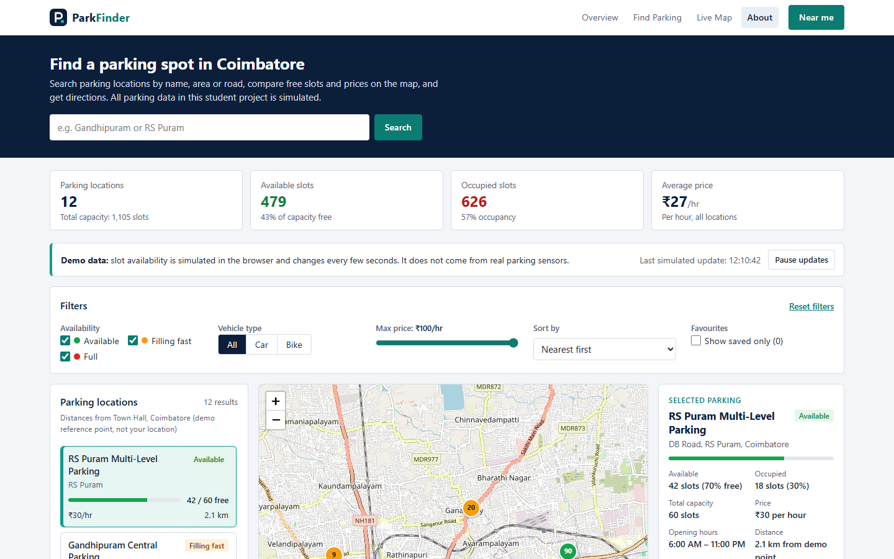 | **Landing page (1440px):** compact navbar, hero with search, calculated statistics, demo-data notice with the last update time |
| 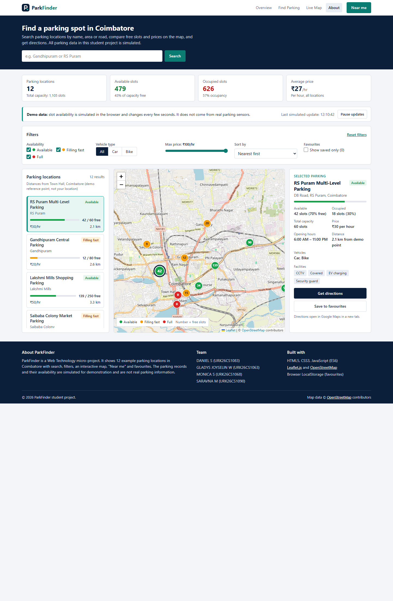 | **Full page:** filters, list / map / details, footer with project information and team |
| 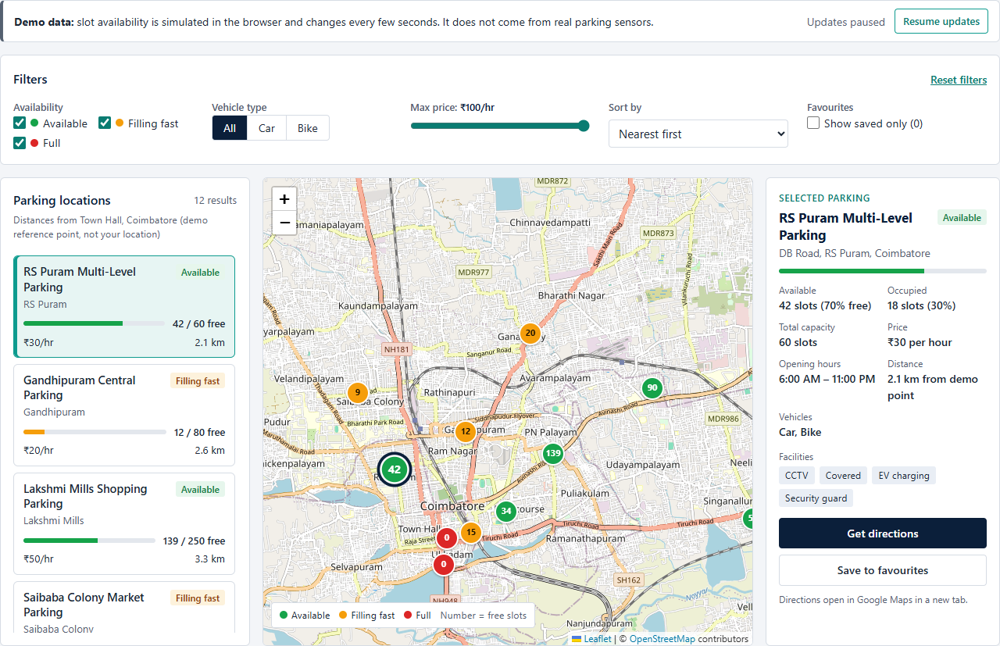 | **Find Parking section:** filter bar, cards, map markers showing free slots, selected parking details |
| 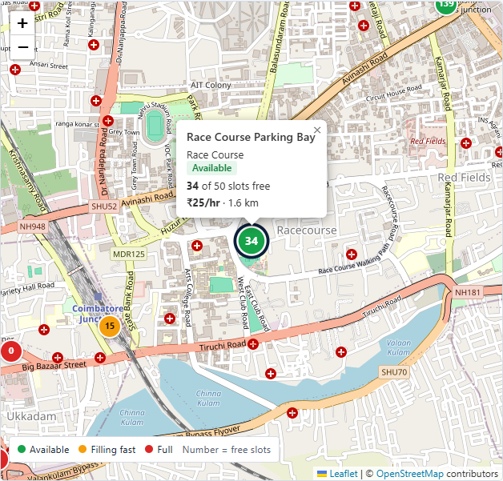 | **Marker popup:** Race Course Parking Bay selected from the map |
| 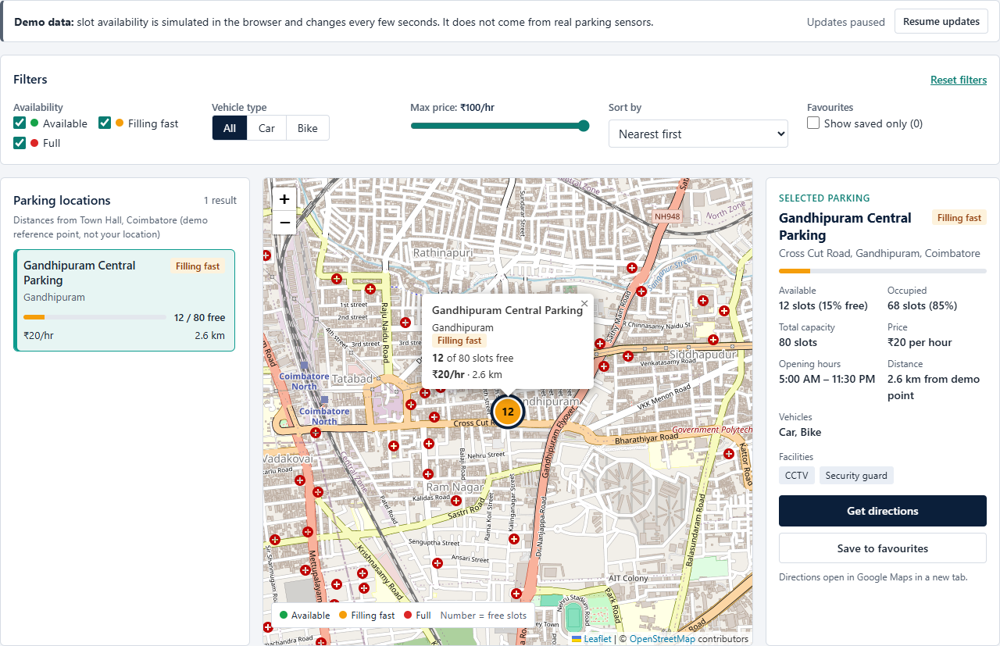 | **Search "Gandhipuram":** 1 result; list, panel and map stay in sync |
| 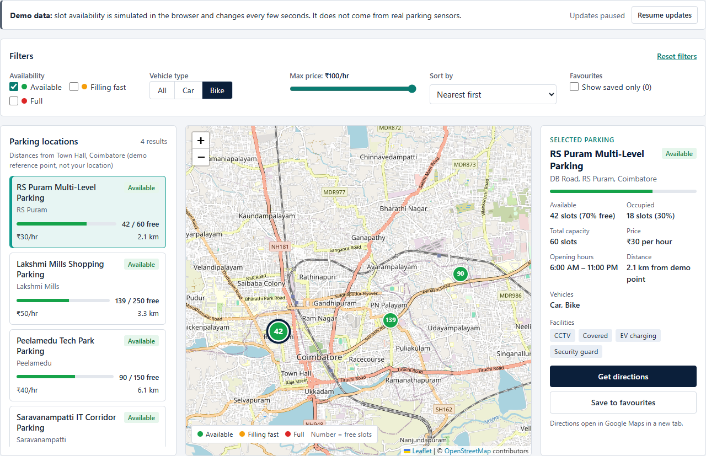 | **Filters:** Available + Bike; only matching markers remain |
| 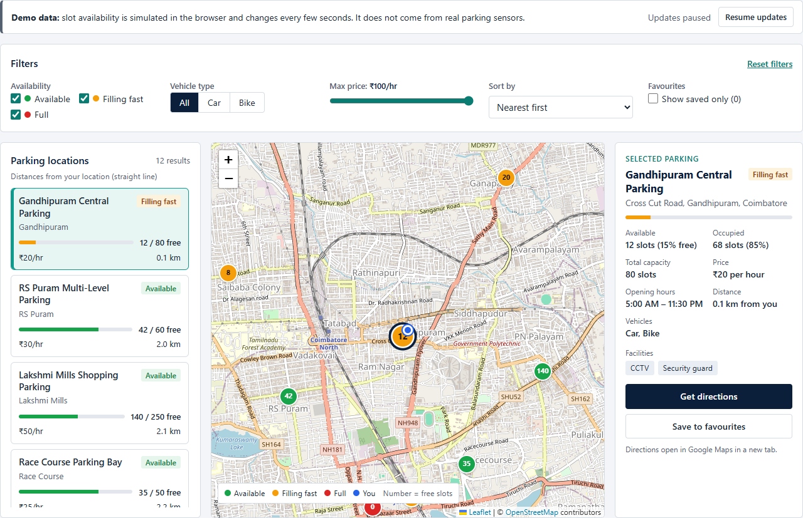 | **Near me:** blue user marker, "Distances from your location", nearest first |
| 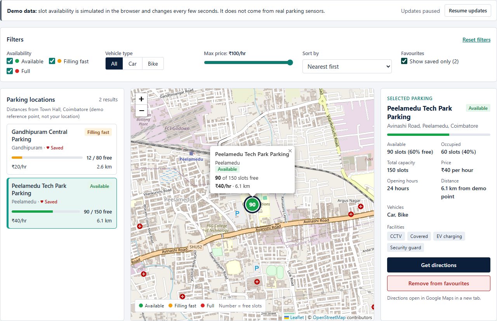 | **Favourites:** "♥ Saved" on cards, "Show saved only (2)", "Remove from favourites" |
| 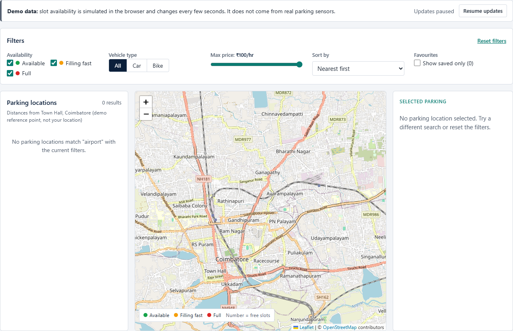 | **Empty state:** search "airport" – no cards, no markers, the panel shows a message |
| 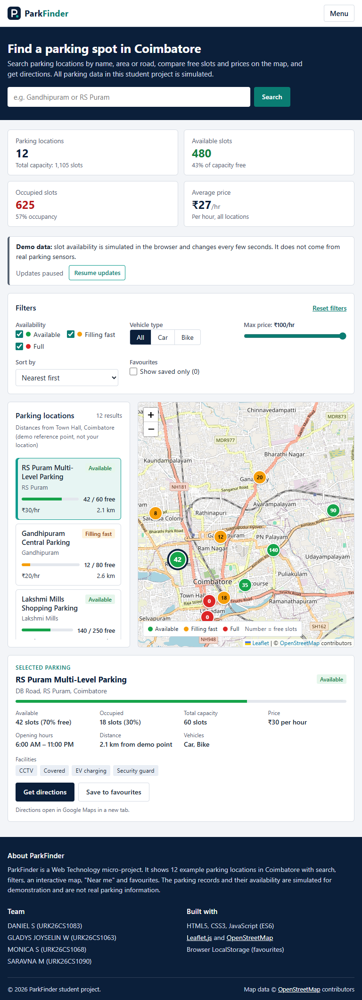 | **Tablet 768px:** Menu button, 2×2 statistics, details under list + map |
| 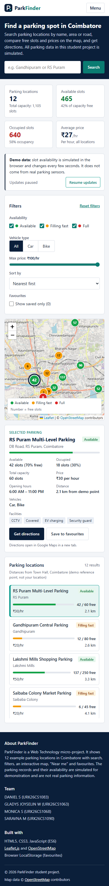 | **Mobile 390px:** one column, map first |
| 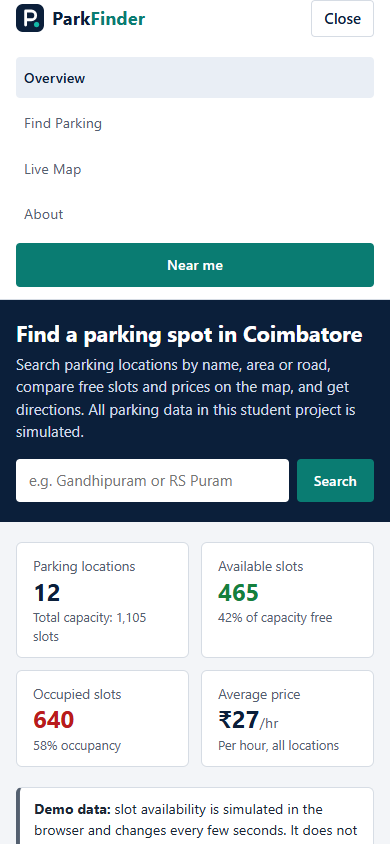 | **Mobile menu** open: it pushes the page down instead of covering it |

---

## 7. Algorithms and Feature Logic

### 7.1 Availability status
```
freeRatio = availableSlots / totalSlots
if availableSlots == 0        → "full"       (red,    "Full")
else if freeRatio > 0.40      → "available"  (green,  "Available")
else                          → "limited"    (orange, "Filling fast")
```
Implemented in `getAvailabilityStatus()`. The status word is also the CSS class suffix (`badge-available`, `marker-limited`, …), so one rule drives every colour. Status is always shown as **text** too (badge words, the number on the marker), never by colour alone. Example: 20 of 50 free = exactly 40% → *Filling fast*.

### 7.2 Dashboard statistics (`reduce()`)
```
totalSlots      = Σ totalSlots            (reduce)
availableSlots  = Σ availableSlots        (reduce)
occupiedSlots   = totalSlots − availableSlots
free %          = availableSlots / totalSlots × 100
occupancy %     = occupiedSlots / totalSlots × 100   (shown as 100 − rounded free %, so both add up to 100)
averagePrice    = Σ price / number of locations
```
With the starting data: 12 locations · capacity 1,105 · available 480 (43%) · occupied 625 (57%) · average ₹26.67 → shown as ₹27/hr. Recalculated after every simulated update from the same array – never hard-coded.

### 7.3 Data check at start-up
`validateDataset()` checks every record: unique id, a name, latitude −90…90, longitude −180…180, `totalSlots` a whole number above 0, `availableSlots` between 0 and `totalSlots`, price not negative, opening hours present, vehicle types only "car"/"bike". Problems are listed in the browser console. The current dataset has none.

### 7.4 Search and filtering (`filter()`, `includes()`)
For every spot, all conditions must be true (logical AND), so filters work together:
```
text      = (name + area + address).toLowerCase()
passes    = (search is empty OR text.includes(search.trim().toLowerCase()))
        AND selectedStatuses.includes(status)
        AND (vehicle == "all" OR spot.vehicleTypes.includes(vehicle))
        AND spot.price <= maxPrice
        AND (not savedOnly OR spot is a favourite)
```
`filter()` returns a **new** array; `PARKING_SPOTS` is never shortened.

### 7.5 Sorting (`sort()` on a copy)
`[...spots].sort(compare)` – the spread `...` copies the array first because `sort()` changes the array it is called on.
| Option | Compare function | Tie-break |
|---|---|---|
| Nearest first | `distance(a) − distance(b)` | – |
| Cheapest first | `a.price − b.price` | nearer first |
| Most available first | `b.availableSlots − a.availableSlots` | nearer first |

### 7.6 Selection synchronisation
```
if the selected spot is still in the results → keep it
else if there are results                    → select the first result
else                                         → select nothing (panel shows an empty message)
```
`getSyncedSelectionId()` runs inside every `updateParkingList()`. Card clicks and marker clicks both call `selectParkingSpot()`, which highlights the card, fills the panel and calls `focusMapOnSpot()` (centre map, highlight marker, open popup).

### 7.7 Map integration (Leaflet)
- `L.map("map").setView([11.022, 76.975], 13)` creates the map centred on Coimbatore.
- `L.tileLayer("https://tile.openstreetmap.org/{z}/{x}/{y}.png", { attribution })` adds OpenStreetMap tiles with the required credit.
- `L.marker([lat, lng], { icon: L.divIcon(...) })` creates one marker per spot **once**; the icon shows the number of free slots in the status colour. `bindPopup()` attaches the popup.
- Markers live in an `L.layerGroup()`. Filtering only calls `addLayer` / `removeLayer`; markers are never duplicated (tested after thousands of updates: still 12).
- `refreshMarkerIcon()` redraws a marker only when its status, number or selection changed.
- A `ResizeObserver` calls `invalidateSize()` when the layout changes the map's size (window resize, phone layout).
- Tile `loading` / `tileerror` / `load` events show "Loading map…" or an error message.

### 7.8 Distances – Haversine formula
```
Δφ = toRadians(lat2 − lat1),  Δλ = toRadians(lng2 − lng1)
a  = sin²(Δφ/2) + cos(φ1)·cos(φ2)·sin²(Δλ/2)
c  = 2 · atan2(√a, √(1−a))
d  = 6371 km × c
```
Implemented in `haversineDistanceKm()`. Distances are **calculated from the coordinates**, never typed in, so they always agree with the map. Until the user shares their location they are measured from the **demo reference point** (Town Hall, Coimbatore), and the list says so: "Distances from Town Hall, Coimbatore (demo reference point, not your location)".

### 7.9 Near me (Geolocation)
| Situation | What happens |
|---|---|
| Permission granted | Distances from the user's position, blue "You" marker, nearest first, nearest visible spot selected, message names it |
| Permission denied | Message "Location permission was denied. Showing distances from Town Hall, Coimbatore (demo reference point) instead." Grey marker labelled *Demo reference point* |
| Location unavailable / timeout | Same as above with "could not be found" / "took too long" |
| Browser without geolocation, or page not secure | Same, with an explanation |

Permission is requested only when **Near me** is clicked. The position is kept only in memory (never in LocalStorage). The app never claims to know the user's location when it doesn't.

### 7.10 Simulated availability (`setInterval`)
```
every 5 seconds:
    pick 3 different random spots
    for each: change = random integer in [−3, +3], not 0
              availableSlots = clamp(availableSlots + change, 0, totalSlots)
    recalculate statistics, statuses, cards, markers, popups and the details panel
    (map not moved, list scroll and keyboard focus kept)
```
`clamp(value, min, max) = Math.min(Math.max(value, min), max)` guarantees 0 ≤ available ≤ capacity, so occupied = capacity − available is never negative. **Pause updates** calls `clearInterval()`; **Resume** calls `setInterval()`; `startSimulation()` never starts a second timer.

### 7.11 Favourites – LocalStorage
- Key: `parkfinder-favourites`; value: JSON text of ids, e.g. `"[2,5]"`.
- `favouriteIds` is a `Set`, so duplicates are impossible.
- Reading uses `try/catch`, `JSON.parse`, `Array.isArray` and keeps only ids that exist in the dataset, so broken or old data cannot crash the app.
- Saving updates the button ("Remove from favourites"), the count, the "♥ Saved" mark on cards, the saved-only filter and shows a message.

### 7.12 Directions
`https://www.google.com/maps/dir/?api=1&destination=LAT,LNG` – Google's documented URL format. The link opens in a new tab with `rel="noopener noreferrer"`.

### 7.13 Navigation
- Phones/tablets (below 960px): a **Menu** button shows the links. The open menu is part of the header, so it **pushes the page down** instead of covering the hero. It closes when a link or Near me is chosen, or with **Esc**.
- The link of the section on screen is highlighted (`setupActiveNavLink`); a clicked link stays highlighted while the page scrolls to it.

### 7.14 Safety and accessibility in code
- Text inserted with `innerHTML` goes through `escapeHTML()`; messages use `textContent`.
- Every form control has a `<label>`; checkbox groups use `<fieldset>`/`<legend>`.
- Cards and markers work with the keyboard (Tab + Enter); visible focus outline.
- `aria-live` regions announce the result count and messages; `aria-expanded`, `aria-pressed`, `aria-current` describe states.
- Phone tap targets are at least ~40px tall.

---

## 8. Testing Results

The application was tested with an automated browser (headless Google Chrome controlled by Playwright) against a local server, on 10 November 2026. Every row below is a check that was actually executed. Expected values were calculated independently from the raw dataset, not copied from the page.

**Result: 57 of 57 checks passed.**

| # | Test case | Result | Evidence |
|---|---|---|---|
| 1 | Dataset is valid (unique ids, coordinates, capacity, prices, hours, vehicles) | ✅ Pass | no problems |
| 2 | Statistics match the dataset | ✅ Pass | 12 locations, 480 available, 625 occupied, capacity 1105, ₹27/hr |
| 3 | Availability % and occupancy % are correct and add up to 100 | ✅ Pass | 43% free + 57% occupied |
| 4 | Status follows the thresholds (0 = Full, >40% = Available, else Filling fast) | ✅ Pass |  |
| 5 | Initial load: 12 cards, 12 markers, RS Puram selected in list, map and panel | ✅ Pass |  |
| 6 | Card shows name, area, status, free/total, price, distance | ✅ Pass | RS Puram Multi-Level Parking Available RS Puram 42 / 60 free ₹30/hr 2.1 km |
| 7 | Distances are calculated from coordinates, and their basis is labelled | ✅ Pass | Distances from Town Hall, Coimbatore (demo reference point, not your location) |
| 8 | Details panel shows available, occupied, capacity, price, hours, distance, vehicles, facilities | ✅ Pass | 42 slots (70% free) / 18 slots (30%) / 60 slots / ₹30 per hour / 6:00 AM – 11:00 PM / 2.1 km from demo point / Car, Bike / 4 facilities |
| 9 | Markers are at the dataset coordinates | ✅ Pass |  |
| 10 | Marker colour and number match each spot's status and free slots | ✅ Pass |  |
| 11 | OpenStreetMap attribution visible | ✅ Pass |  Leaflet / © OpenStreetMap contributors |
| 12 | Zoom controls work | ✅ Pass | 13 -> 14 |
| 13 | Map height is sensible on desktop (not stretched) | ✅ Pass | 598px |
| 14 | Clicking a marker opens the correct popup | ✅ Pass | Race Course Parking Bay Race Course Available 35 of 50 slots free ₹25/hr · 1.6 km |
| 15 | Clicking a marker selects its card and updates the panel | ✅ Pass |  |
| 16 | Clicking a card centres the map, highlights the marker and opens its popup | ✅ Pass |  |
| 17 | Search by parking name | ✅ Pass |  |
| 18 | Search by area (case-insensitive, ignores leading/trailing spaces) | ✅ Pass |  |
| 19 | Search by address | ✅ Pass | 11,12 |
| 20 | No-result search shows an empty state (list, panel, no markers) | ✅ Pass | No parking locations match "airport" with the current filters. |
| 21 | Clearing the search restores all 12 cards and markers and a selection | ✅ Pass |  |
| 22 | Enter key / Search button runs the search | ✅ Pass |  |
| 23 | Availability filter: Available only | ✅ Pass | Available only: 6 shown, 6 expected, 6 markers |
| 24 | Availability filter: Full only | ✅ Pass | Full only: 2 shown, 2 expected, 2 markers |
| 25 | Availability filter: two statuses at once | ✅ Pass | Filling fast + Full: 6 shown, 6 expected, 6 markers |
| 26 | No availability ticked shows the empty state | ✅ Pass |  |
| 27 | Vehicle filter: car | ✅ Pass | car: 9 shown, 9 expected, 9 markers |
| 28 | Vehicle filter: bike | ✅ Pass | bike: 10 shown, 10 expected, 10 markers |
| 29 | Vehicle filter: All | ✅ Pass |  |
| 30 | Maximum price filter (₹30) and its label | ✅ Pass | max ₹30: 9 shown, 9 expected, 9 markers, label ₹30/hr |
| 31 | Filters work together (Available + Car + ₹30 + search) | ✅ Pass | combined: 3 shown, 3 expected, 3 markers |
| 32 | Sort nearest first (with Bike filter on) | ✅ Pass | 0.034582591254439465, 0.6, 0.6, 2.1, 2.6, 3.3, 4.1, 5.3, 6.1, 10.2 |
| 33 | Sort cheapest first (with Bike filter on) | ✅ Pass | 15, 15, 20, 20, 20, 30, 30, 35, 40, 50 |
| 34 | Sort most available first (with Bike filter on) | ✅ Pass | 140, 90, 60, 42, 20, 18, 12, 8, 0, 0 |
| 35 | Sorting does not change the original dataset order | ✅ Pass | 1,2,3,4,5,6,7,8,9,10,11,12 |
| 36 | Reset restores every control, all cards and markers, and the default selection | ✅ Pass | {"search":"","all":true,"vehicle":"all","price":"100","label":"₹100/hr","sort":"distance","saved":false} |
| 37 | Favourites-only with nothing saved shows a helpful message | ✅ Pass | You haven't saved any parking locations yet. Select a location and press Save. |
| 38 | Save to favourites updates storage, count, button, card marks and message | ✅ Pass | {"stored":"[2,5]","count":"2","label":"Remove from favourites","pressed":"true","marks":2,"toast":"Saved \"Peelamedu Tech Park Parking\" to favourites."} |
| 39 | Remove from favourites works and re-saving creates no duplicate | ✅ Pass | [2] then [2,5] |
| 40 | Favourites remain after browser refresh; saved-only filter shows them | ✅ Pass |  |
| 41 | Broken LocalStorage data does not crash the app | ✅ Pass |  |
| 42 | Simulation updates statistics, cards, statuses, markers and the panel together | ✅ Pass | {"changed":5,"statsOk":true,"cards":true,"markers":true,"panel":true,"time":"Last simulated update: 12:04:11"} |
| 43 | Pause updates stops the simulation | ✅ Pass | {"btn":"Resume updates","time":"Updates paused"} |
| 44 | Resume restarts updates and never creates a second timer | ✅ Pass | {"sameTimer":true,"changed":true} |
| 45 | Availability stays between 0 and capacity (5000 extra updates) | ✅ Pass |  |
| 46 | No duplicate markers after thousands of re-renders | ✅ Pass | 12 markers |
| 47 | Get directions opens Google Maps for the selected spot in a new tab | ✅ Pass | https://www.google.com/maps/dir/?api=1&destination=11.0096,76.9502 |
| 48 | Near me (permission granted): user marker, distances from user, nearest first, nearest selected | ✅ Pass | Nearest parking: Gandhipuram Central Parking, 0.1 km away (straight line). |
| 49 | Near me (denied): clear message, labelled demo reference point, app still works | ✅ Pass | Location permission was denied. Showing distances from Town Hall, Coimbatore (demo reference point) instead. |
| 50 | Near me (unavailable): clear message, labelled demo reference point, app still works | ✅ Pass | Your location could not be found. Showing distances from Town Hall, Coimbatore (demo reference point) instead. |
| 51 | Near me (timeout): clear message, labelled demo reference point, app still works | ✅ Pass | Finding your location took too long. Showing distances from Town Hall, Coimbatore (demo reference point) instead. |
| 52 | Near me (browser without geolocation): message + demo reference point | ✅ Pass | This browser does not support location. Showing distances from Town Hall, Coimbatore (demo reference point) instead. |
| 53 | Responsive layout at 1440/1280/1024/768/390/360 + mobile navigation | ✅ Pass | 1440px: overflow 0, map 598px, stats 4 cols, menu button false 1280px: overflow 0, map 598px, stats 4 cols, menu button false 1024px: overflow 0, map 558px, stats 4 cols, menu button false 768px: overflow 0, map 518px... |
| 54 | Every navbar link scrolls to its section and becomes highlighted | ✅ Pass | [{"text":"Overview","visible":true,"active":true},{"text":"Find Parking","visible":true,"active":true},{"text":"Live Map","visible":true,"active":true},{"text":"About","visible":true,"active":true}] |
| 55 | Keyboard: Enter on a focused card selects it | ✅ Pass |  |
| 56 | No JavaScript errors or unexpected warnings in the console | ✅ Pass | only the intended warning from the corrupted-storage test (1) |
| 57 | No broken local files (HTML, CSS, JS, logo) | ✅ Pass |  |

**Notes**
- Geolocation "granted" was tested by giving the test browser a fixed position next to Gandhipuram. "Denied", "unavailable", "timeout" and "not supported" were tested by making the browser's location request fail with each error.
- The "broken LocalStorage" check deliberately stores invalid text; the app shows one console warning and carries on. No other warnings or errors appeared.
- The only failed network requests were OpenStreetMap tiles **cancelled by Leaflet** while the map moved (`net::ERR_ABORTED`) – normal behaviour.

**Manual checks still recommended:** the real location permission prompt on your own laptop/phone; Live Server on your machine; touch on a real phone; behaviour with no internet connection.

---

## 9. Limitations
1. **Simulated data:** locations, capacities, prices, hours and facilities are invented for demonstration; availability changes are random, not from sensors.
2. **Internet required:** map tiles and Leaflet are loaded online.
3. **Straight-line distances:** Haversine gives "as the crow flies" distance, not road distance or travel time.
4. **Demo reference point:** without location permission, distances are from Town Hall, not from the user (clearly labelled).
5. **Favourites are per browser:** stored in LocalStorage, not synchronised across devices; clearing browser data removes them.
6. **No booking or payment:** ParkFinder only helps find and compare parking.
7. **OpenStreetMap tile usage policy:** suitable for a demo, not for heavy production traffic.
8. **Single city:** the dataset covers Coimbatore only.

## 10. Future Enhancements
1. Connect to real parking sensors or a city open-data API through a backend.
2. Slot booking and digital payment.
3. Road-distance and travel-time routing (e.g. an open routing service).
4. Notifications when a favourite spot is about to fill up.
5. Marker clustering for hundreds of locations; multi-city support.
6. Accessible-parking, EV-charger and covered-parking filters.
7. Occupancy history charts and predictions of busy times.
