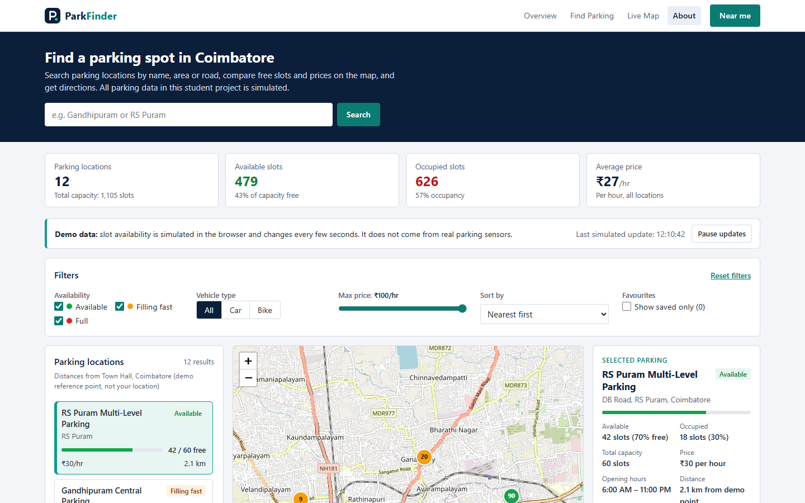

# ParkFinder – Smart City Parking Finder

A responsive front-end web application that helps users find parking in **Coimbatore** using an interactive map, live search, filters, sorting, a "Near me" feature, favourites and Google Maps directions.

Built as a **Web Technology micro-project** with HTML5, CSS3 and vanilla JavaScript (ES6). There is no backend.

**Team:** DANIEL S (URK26CS1083) · GLADYS JOYSELIN W (URK26CS1063) · MONICA S (URK26CS1068) · SARAVNA M (URK26CS1090)

> ⚠️ **Dataset disclaimer:** all 12 parking locations, slot counts, prices, opening hours and facilities are **simulated demonstration data**. They are **not** verified real-world parking inventory. The changing availability is generated in the browser by JavaScript (`setInterval`) and is **not** real sensor or server data. Area and road names are real Coimbatore places; coordinates are approximate.



---

## Features

| Feature | Details |
|---|---|
| **Dashboard** | Compact navbar, short hero with search, four calculated statistics, demo-data notice, filters, parking list, map, selected parking details, About footer |
| **Statistics** | Locations, total capacity, available and occupied slots, free % and occupancy %, average price – all calculated from the data |
| **Parking cards** | Built by JavaScript: name, area, status, free / total slots, price, distance |
| **Availability status** | *Available* (more than 40% free) · *Filling fast* (1%–40% free) · *Full* (0 free) – shown as text and colour |
| **Search** | By name, area or address; case-insensitive; updates while typing; Enter / Search button |
| **Filters** | Availability (multi-select), vehicle (All / Car / Bike), maximum price, saved only – all work together |
| **Sorting** | Nearest first · Cheapest first · Most available first |
| **Reset filters** | Restores every filter, the full list, the default selection and the map view |
| **Interactive map** | Leaflet + OpenStreetMap; markers show the number of free slots in the status colour; popups; synced with cards and details |
| **Distances** | Calculated from the coordinates (Haversine). Measured from a labelled demo reference point (Town Hall) until the user shares their location |
| **Simulated availability** | Every 5 seconds, 3 random locations change by up to ±3 slots (never below 0 or above capacity); Pause / Resume |
| **Near me** | Asks for location only when clicked; blue "You" marker; nearest first. If location is denied or unavailable, it clearly falls back to the demo reference point |
| **Directions** | Opens Google Maps directions to the selected spot in a new tab |
| **Favourites** | Save / remove spots; "♥ Saved" on cards; "Show saved only"; kept after refresh with LocalStorage |
| **Responsive** | Desktop, laptop, tablet (1024 / 768px) and phones (390 / 360px); mobile Menu button |
| **Accessible** | Labelled controls, keyboard support, visible focus, screen-reader announcements |

## Technology stack

- **HTML5** – page structure
- **CSS3** – variables, Flexbox, Grid, media queries
- **JavaScript (ES6)** – logic, DOM updates, events
- **Leaflet.js 1.9.4** – interactive map (CDN)
- **OpenStreetMap** – map tiles
- **Browser LocalStorage** – favourites
- **Geolocation API** – "Near me"
- **Google Maps URL** – external directions

No frameworks, build tools, web fonts or backend.

## Installation and setup

1. Install [Visual Studio Code](https://code.visualstudio.com/).
2. In VS Code, open **Extensions** (`Ctrl+Shift+X`), search **Live Server** (by Ritwick Dey) and install it.
3. Copy the `Smart-City-Parking-Finder` folder to your computer.

## How to run (VS Code Live Server)

1. **File → Open Folder…** and choose `Smart-City-Parking-Finder`.
2. Right-click `index.html` → **Open with Live Server**.
3. The browser opens `http://127.0.0.1:5500/index.html`.
4. Keep an **internet connection** on (map tiles and Leaflet load online).

> "Near me" only works on `http://localhost` / `http://127.0.0.1` (Live Server) or `https://`. If you double-click `index.html` (`file://`), the app explains this and uses the demo reference point.

## Project folder structure

```
Smart-City-Parking-Finder/
├── index.html                 Page structure
├── readme.md                  This file
├── assets/
│   ├── icons/logo.svg         Logo and browser-tab icon
│   └── images/
├── css/
│   └── style.css              All styling
├── js/
│   ├── data.js                Settings + 12 simulated parking records (data only)
│   ├── map.js                 Leaflet map, markers, popups, reference marker
│   └── script.js              Data check, statistics, distances, search, filters,
│                              sorting, rendering, selection, favourites, near me,
│                              simulation, navigation, start-up
└── docs/
    ├── 01-Technical-Documentation.md
    ├── 02-Presentation-Content.md
    ├── 03-Presentation-Script.md
    ├── 04-Viva-and-Concepts-Guide.md
    └── screenshots/           Real screenshots of the application
```

Scripts load in this order (all with `defer`): **Leaflet → data.js → map.js → script.js**.

## Usage

| I want to… | Do this |
|---|---|
| Find parking in an area | Type in the search bar, e.g. `Gandhipuram` – results update as you type |
| See only spots with space | Untick **Filling fast** and **Full** |
| Park a bike | Choose **Bike** under Vehicle type |
| Stay under a budget | Drag **Max price** to e.g. ₹30/hr |
| Change the order | **Sort by** → Nearest / Cheapest / Most available |
| See details | Click a card **or** a map marker |
| Find the nearest parking | Click **Near me** and allow location |
| Get there | Click **Get directions** (opens Google Maps) |
| Remember a spot | Click **Save to favourites**; tick **Show saved only** to list them |
| Start again | Click **Reset filters** |
| Freeze the numbers | Click **Pause updates** in the demo-data notice |
| Use on a phone | Tap **Menu** for the links; **Close** or Esc hides them |

## Dataset

`js/data.js` holds one array, `PARKING_SPOTS`, with 12 records. Each record has:
`id, name, area, address, availableSlots, totalSlots, price, latitude, longitude, vehicleTypes, openingHours, facilities`.

Distances are **not** stored; they are calculated from `latitude`/`longitude`. The records are checked at start-up (`validateDataset`), and any problem is reported in the browser console.

Starting totals: **12 locations · 1,105 slots · 480 available (43%) · 625 occupied (57%) · average ₹27/hr**. These change while the simulation runs.

## Known limitations

- All parking data and availability changes are simulated.
- An internet connection is needed for the map.
- Distances are straight-line (Haversine), not road distance.
- Without location permission, distances are from the demo reference point (Town Hall), not from you.
- Favourites are stored only in this browser (not synced; cleared with browser data).
- No booking or payment. One city (Coimbatore).

## Documentation

- [Technical documentation](docs/01-Technical-Documentation.md) – overview, tag description, full code, algorithms, test results
- [Presentation content](docs/02-Presentation-Content.md) – slide-by-slide content with screenshots
- [Presentation script](docs/03-Presentation-Script.md) – 20-minute script for the team
- [Viva and concepts guide](docs/04-Viva-and-Concepts-Guide.md) – beginner explanations and viva Q&A

## Credits

Map data © [OpenStreetMap](https://www.openstreetmap.org/copyright) contributors · Map library [Leaflet](https://leafletjs.com).
